# AI 스마트 바텐더 v2 — 초보자용 제작(조립) 가이드

> 팀 **홍당무** · 안양대학교 정보전기전자공학과 캡스톤디자인Ⅱ (2026/2학기) · 작성 2026-11-06 · **SPEC v2.1 반영** · 앱 v3.0 반영 2026-11-07
> 목표: 2학기 **졸업작품 시제품** · **기말 시연(발표)** · 졸업논문·특허용 실험 데이터
> 과제: 사용자의 감정 및 취향 분석 기반 AI 맞춤형 음료 및 칵테일 배합 메이커
>
> **기준 문서** (이 가이드와 숫자가 다르면 아래 문서가 우선입니다)
> - 시스템 명세: `../../docs/SPEC.md` (v3.0 — 핀맵 · BLE 프로토콜은 v2.1 그대로 · 앱 동작)
> - 부품 목록(BOM): `../BOM.md`, `../BOM.xlsx`, `../research/canonical_bom.json` (부품 번호 **P01~P69**)
> - 부품 조사·재단표: `../research/parts_research.md`
> - 회로도·실물 배선도: `../circuit/회로도.html` (`../circuit/schematic.svg`, `../circuit/wiring.svg`)
> - 펌웨어 설명서: `../../firmware/README.md`, 앱 설명서: `../../app/README.md`
> - 앱 v3.0 받기: 웹앱 [https://paperji.github.io/smart-bartender/](https://paperji.github.io/smart-bartender/) (Chrome·Edge) · 안드로이드 APK / Windows EXE [https://github.com/paperji/smart-bartender/releases/latest](https://github.com/paperji/smart-bartender/releases/latest)

## 이 가이드 읽는 법 {#howto}

- 부품 이름 뒤의 **P번호**(예: 수중펌프 P09)는 BOM 번호와 같습니다. 부품 상자에도 P번호를 적어 두면 찾기 쉽습니다.
- 전선 번호 **①~㊱**은 회로도 산출물 `../circuit/회로도.html`의 "③ 연결표"와 `../circuit/wiring.svg`(배선도)의 동그라미 번호와 **같습니다**. [STEP5 연결표](#wiring-table)에 같은 번호로 옮겨 적었습니다. 전선 양 끝에 마스킹테이프로 번호를 붙이세요.
- 회로 기호(U1, K1~K4 = 릴레이 채널 1~4, M1~M4, D1~D4, J1, SW1, SW2, F1, TB1(+5V)·TB2(GND)·TB3(3V3), C1, R1, LED1, BZ1)는 회로도와 같습니다.
  단, **"M1"은 회로도에서는 펌프 1**, 재단표에서는 **노즐 판(패널 M1)** 이라 두 가지로 쓰입니다. 이 가이드에서는 펌프는 "펌프 1~4", 판은 "노즐 판 M1"이라고 적습니다.
- 각 STEP은 **목표 → 준비물 → 소요 시간 → 그림 → 절차 → 확인 포인트(✔) → 흔한 실수(⚠)** 순서입니다.
  절차 속 *"왜?"* 는 그렇게 하는 이유입니다. 이유를 알면 실수가 줄어듭니다.
- `□` 체크박스는 인쇄해서 펜으로 표시하며 진행하세요. (인쇄용: `조립가이드.html` → Ctrl+P → A4)
- 좌표는 **x = 왼쪽→오른쪽(앞에서 볼 때), y = 앞→뒤, z = 바닥판 윗면에서 잰 높이**, 단위는 mm입니다.
- "추정"이라고 쓴 숫자는 계산이나 자료로 짐작한 값이라 **직접 재서 확인**해야 합니다.

## 목차 {#toc}

- [0. 완성 사양 · 동작 개요](#s0)
- [1. 안전 수칙](#s1)
- [2. 준비물](#s2)
- [3. 단계별 제작](#s3)
  - [STEP 1. 부품 검수 · 멀티미터 기초](#step1)
  - [STEP 2. 브레드보드 단위 테스트](#step2)
  - [STEP 3. 펌프 리드선 연장 · 납땜 · 열수축 · 다이오드](#step3)
  - [STEP 4. 전원부 (DC 단자 · 스위치 · 퓨즈 · 분배 커넥터 · 커패시터)](#step4)
  - [STEP 5. ESP32 · 릴레이 영구 배선 (연결표)](#step5)
  - [STEP 6. 전원 넣기 전 점검 · 첫 전원 투입](#step6)
  - [STEP 7. 펌웨어 업로드 · 앱 블루투스 연결](#step7)
  - [STEP 8. 배관 (튜브 · 체크밸브 · 누수 테스트)](#step8)
  - [STEP 9. 외형 제작 (재단 · 구멍 · 조립 · 방수)](#step9)
  - [STEP 10. 최종 조립 · 배선 정리](#step10)
  - [STEP 11. 캘리브레이션 (유량 맞추기)](#step11)
  - [STEP 12. 시운전 · 세척 · 보관](#step12)
- [4. 문제 해결 표](#s4)
- [5. 시연(발표) 체크리스트](#s5)
- [6. 개선 아이디어](#s6)
- [부록 A. 핀맵 요약](#appA) · [부록 B. 재단표](#appB) · [부록 C. 캘리브레이션 기록표](#appC)

<!-- pagebreak -->

## 0. 완성 사양 · 동작 개요 {#s0}

### 0.1 완성 사양

| 항목 | 내용 |
|---|---|
| 외형 | 폭 420 × 깊이 260 × 높이 380 mm (고무발 10mm 별도), 흰색 포맥스 5T |
| 구조 | 위: 전장부(전자 부품 박스) / 아래 뒤: 용기 칸(용기 4개) / 아래 앞 가운데: 잔 칸 |
| 재료 수 | 4가지 (펌프 1~4). 두 번째 릴레이(P08 예비)를 달면 8가지까지 확장 가능 (펌웨어 `PUMP_COUNT`) |
| 용기 | 0.7~1.2L 식품용 밀폐용기 4개 (외곽 폭 ≤ 95, 깊이 ≤ 135, 높이 ≤ 170 mm) |
| 노즐 높이 | z 230 mm (용기 최대 액면 z 160보다 70mm 높음) → 잔 높이 약 200mm까지 |
| 제조량 | 한 잔 30~500 ml (재료 1개 최대 300 ml, 펌프 1개 최대 120초) — SPEC §2.3 |
| 유량 | 약 3~6 ml/초 (체크밸브 포함, **추정**). 캘리브레이션으로 펌프마다 실제 값 저장 |
| 한 잔(200 ml) 시간 | 약 35~65초 (추정) |
| 전원 | DC 5V 4A 어댑터(P11) → 로커 스위치 SW1 → 3A 퓨즈 F1 → 분배 커넥터 TB1(+5V)·TB2(GND)·TB3(3V3) |
| 제어 | ESP32 DevKitC(P01) + 4채널 릴레이(P08), 펌웨어 v2.1.0 |
| 통신 | 블루투스 저전력(BLE, Nordic UART). 공유기·IP 주소 필요 없음 |
| 조작 | 스마트폰 앱 + 기기 앞면 시작/정지 버튼(비상정지) + 상태 LED + 부저 |

### 0.2 동작 순서 (한 잔이 만들어지기까지)

1. 사용자가 앱에 기분·맛·도수·날씨·상황·성향과 잔 용량을 입력합니다.
2. 앱이 **기기에 장착된 재료 목록**(펌프 1~4의 이름·종류·도수·잔량)과 함께 Google Gemini에 보냅니다. 이때 앱 설정에 등록한 **사용자 본인의 Gemini API 키**를 씁니다(팀 서버 없음).
3. AI(Gemini)가 장착된 재료만으로 레시피(재료별 ml)를 만들어 돌려주면, 앱이 SPEC §3.3 규칙으로 다시 검증·보정합니다. 키가 없거나 AI가 안 되면 앱이 자체 규칙(오프라인 추천)으로 추천합니다.
4. 사용자가 레시피를 확인·조정하고 **제조 시작**을 누르면, 앱이 블루투스로 `{"cmd":"make", ...}` 명령을 보냅니다.
5. ESP32가 `구동 시간 = ml ÷ 유량(ml/초)`을 계산해 릴레이를 켜고 끕니다. 릴레이가 켜진 동안 해당 펌프가 용기 속 액체를 밀어 올립니다.
6. 액체는 튜브 → 체크밸브 → 노즐을 지나 잔으로 떨어집니다. 펌프는 하나씩 차례로(순차 모드) 돌아갑니다.
7. 끝나면 기기가 `done`을 보내고 부저가 "삐-삐" 울립니다. 휴대폰에는 완료 알림과 진동이 옵니다. 앱은 잔량을 줄이고 기록을 남깁니다.
8. 맛 평가(좋아요/별로예요)를 하면 앱이 "한 잔 더 만들까요?"를 묻습니다. [예] → 같은 입력으로 다시 추천, [아니요, 다른 걸 원해요] → 새 재료를 제안하는 **탐색 모드**(SPEC §5).

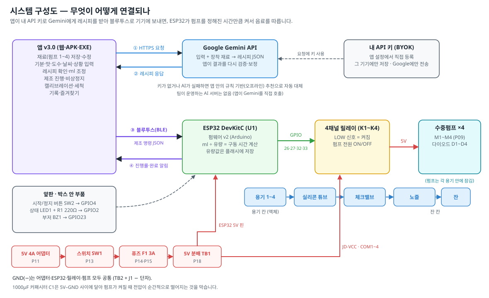

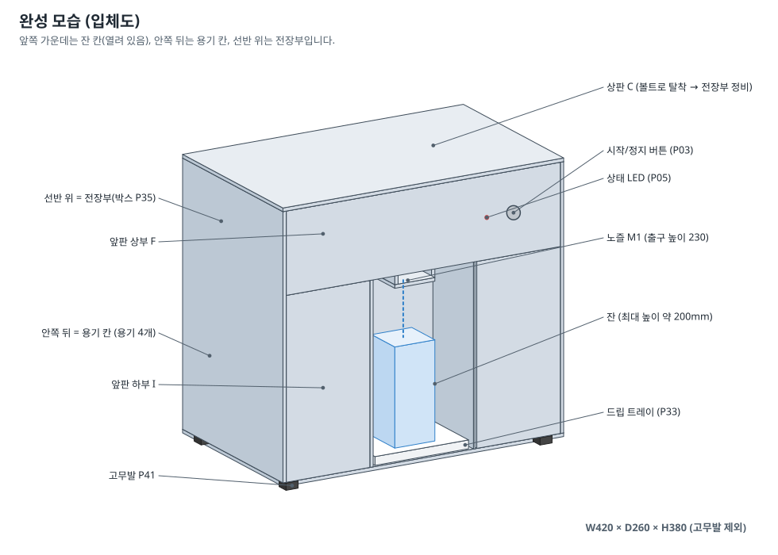

### 0.3 세 구역으로 나누는 이유

- **전장부(선반 위)**: ESP32·릴레이·전원 부품을 닫힌 박스(P35)에 넣고 선반 위에 둡니다. *왜?* 액체는 아래로 흐르므로, 전기 부품을 액체보다 **위**, 그리고 **선반으로 막힌 곳**에 두면 물이 튀거나 새도 닿지 않습니다.
- **용기 칸(아래 뒤)**: 무거운 용기를 바닥에 두어 무게 중심이 낮아집니다(넘어짐 방지). 뒤 덮개(H)를 열고 용기를 뒤로 꺼내 채웁니다.
- **잔 칸(아래 앞 가운데)**: 앞이 열려 있어 잔을 넣고 빼기 쉽고, 드립 트레이(P33)가 떨어지는 방울을 받습니다.
- **노즐은 용기 액면보다 높게**: 노즐이 액면보다 낮으면 펌프가 꺼져도 빨대 원리(사이펀)로 액체가 계속 흘러나옵니다. 이 기기는 노즐(z 230)이 최대 액면(z 160)보다 70mm 높습니다.

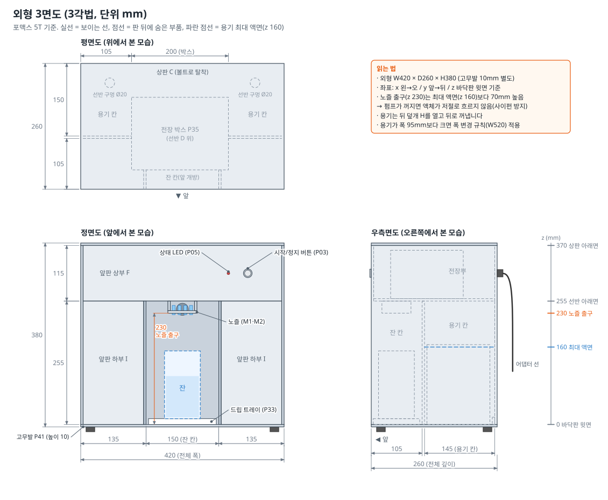

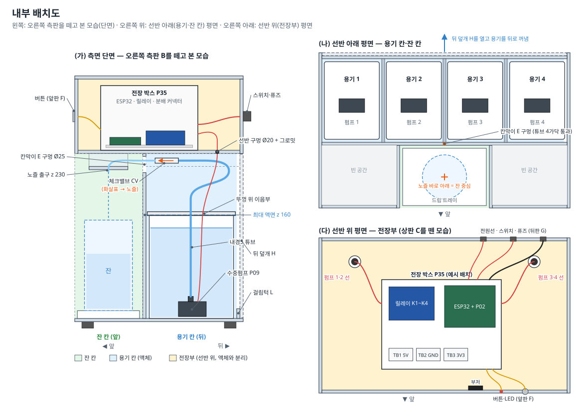

### 0.4 전기 연결 요약 (SPEC §1)

| 기능 | ESP32 핀 | 연결 대상 |
|---|---|---|
| 펌프 1~4 | GPIO 26 / 27 / 32 / 33 | 릴레이 IN1 / IN2 / IN3 / IN4 (LOW = 켜짐) |
| 시작/정지 버튼 SW2 (P03) | GPIO 4 | 버튼 → GND (내부 풀업) |
| 상태 LED1 (P05) + R1 220Ω (P06) — **필수** | GPIO 2 | GPIO2 → R1 → LED 긴 다리(+), 짧은 다리(−) → GND. 보드에 GPIO2 LED가 없어 외부 LED 필수 |
| 부저 BZ1 (P04, 선택) | GPIO 23 | 부저 I/O (**HIGH = 울림**), VCC = 3V3 (TB3) |
| 릴레이 입력측 전원 | 3V3 (TB3) | 릴레이 VCC 핀. **A안(기본)**: JD-VCC 점퍼 제거. **B안**(A안으로 안 켜질 때): USB·어댑터를 모두 뺀 뒤 ⑪(3V3)을 **먼저** 뽑고 → ⑨(+5V)를 JD-VCC 핀에서 이 VCC 핀으로 옮기고 → 점퍼 캡을 끼워 VCC = JD-VCC = 5V(점퍼 헤더가 2핀이라 JD-VCC 핀에는 캡만) — **B안에서 VCC를 3V3에 연결 금지** |
| 릴레이 코일 전원 | 5V 레일 (TB1) | 릴레이 JD-VCC 핀 (B안: 입력 헤더 VCC 핀 → 점퍼 캡 → JD-VCC) |
| ESP32 전원 | 5V 레일(TB1) → **5V 핀** | USB를 꽂을 때는 이 선(⑧)을 뺌 |
| 공통 GND (별형 접지) | GND | J1 − 나사에서 두 갈래로 나눔: ⑤ → TB2(펌프 −), ⑦ → ESP32 GND(ESP32·릴레이). 전기적으로는 모두 공통 |
| 전원 경로 | — | 어댑터 → J1 → SW1(스위치) → F1(3A 퓨즈) → TB1(+5V 분배). TB2 = GND 분배, TB3 = 3V3 분배 |

> 참고: 회로도 전체는 `../circuit/회로도.html`을 함께 인쇄해서 옆에 두고 보세요. 이 가이드는 **배선 순서**와 **만드는 방법**을 설명하고, 전기적 연결은 회로도와 SPEC 핀맵을 그대로 따릅니다.

<!-- pagebreak -->

## 1. 안전 수칙 {#s1}

### 1.1 전기

- [ ] **배선을 바꾸거나 손댈 때는 항상 어댑터를 콘센트에서 뽑습니다.** 스위치(SW1)만 끄는 것으로는 J1 단자까지 전기가 살아 있습니다.
- [ ] 5V는 감전 위험은 거의 없지만, **+와 −가 직접 닿으면(단락)** 수 A가 흘러 전선이 뜨거워지고 피복이 녹을 수 있습니다. 단락이 나면 **먼저 어댑터(P11)의 내장 보호가 출력을 끊고**(꺼졌다 켜졌다 반복), 3A 퓨즈(F1)는 어댑터 보호가 고장 났거나 더 센 어댑터를 쓸 때를 위한 **백업 보호**입니다. 5V 4A 어댑터로는 단락이 나도 퓨즈가 끊어지지 않을 수 있으므로 **"퓨즈가 멀쩡하다 = 배선이 맞다"가 아닙니다.** 퓨즈를 더 큰 값이나 철사로 바꾸지 마세요.
- [ ] **USB와 어댑터 5V를 동시에 ESP32에 넣지 않습니다(이중 전원 금지).** USB를 꽂기 전에 ⑧(TB1 → ESP32 5V 선)을 뽑고, **뽑은 끝은 테이프로 감쌉니다**(STEP7). PC USB 포트나 보드가 상할 수 있습니다.
- [ ] 극성(+/−)이 있는 부품(다이오드·커패시터·LED·DC 단자)은 그림 6과 비교해 확인한 뒤 연결합니다.
- [ ] **벤치 테스트(STEP2)에는 아직 퓨즈(F1)가 없습니다.** 어댑터를 꽂기 전에 멀티미터로 +5V 레일–GND 레일이 단락(0Ω, 계속 "삐")이 아닌지 보고, 냄새·열이 나면 바로 어댑터를 뽑습니다.
- [ ] 젖은 손으로 전원부를 만지지 않습니다. 액체를 쏟으면 먼저 어댑터를 뽑고 닦습니다.
- [ ] 어댑터(P11)의 콘센트 쪽(220V)은 절대 분해하지 않습니다.

### 1.2 공구

- [ ] **인두(약 350℃), 열풍기(250~300℃), 글루건**은 화상 위험이 큽니다. 인두는 항상 스탠드에 두고, 열풍기 노즐은 사용 후 5분간 만지지 않습니다.
- [ ] 납땜 연기는 들이마시지 않게 창문을 열거나 선풍기로 옆으로 날립니다. 납땜 후 손을 씻습니다.
- [ ] 드릴·스텝드릴을 쓸 때는 판을 클램프로 고정하고 보안경을 씁니다. **회전 공구를 쓸 때는 장갑을 끼지 않습니다**(장갑이 말려 들어갈 수 있음).
- [ ] 커터칼은 쇠자를 대고 몸 바깥쪽으로 긋습니다. 커팅매트 위에서 작업합니다.

### 1.3 식품 위생 — 지금 부품으로는 아무도 마시지 않습니다 {#food}

- [ ] 이 기기의 **펌프(P09)·실리콘 튜브(P29·P30)·체크밸브(P31)는 "식품 등급" 표기가 없습니다**(체크밸브는 판매처 설명상 "공기용"이고, 펌프 본체·덕빌 밸브 고무·윤활제 재질도 확인되지 않았습니다). 식품에 닿아도 안전한지는 **알코올이 있든 없든 똑같은 문제**입니다. 그래서
  - 튜브(P29·P30)와 체크밸브(P31)를 **식품용 표기(FDA·LFGB 등)가 있는 부품**(선택 품목 **P65·P66·P67**, BOM 4.2절 — 가격 확인 필요)으로 바꾸고 펌프 재질을 확인하기 전까지는(또는 연동 펌프 P55로 바꾸기 전까지는) **기기에서 나온 액체를 아무도 마시지 않습니다.** 관람객에게도 주지 않습니다.
  - 기말 시연·졸업작품 전시의 시연은 **물이나 식용색소를 탄 물(색 물)을 컵에 따르는 것까지**만 합니다. 색 물을 쓰면 레시피별 비율 차이가 눈에 보여 시연 효과도 좋습니다.
  - 이와 별개로 학교 시연·전시에서는 **주류를 쓰지 않습니다**(학교 규정, 펌프·튜브의 알코올 내성 미확인 — 1.4).
  - 처음 쓰기 전과 매번 쓴 뒤에 **세척**합니다(STEP12).
- [ ] 시음이 꼭 필요하면(예: 졸업작품 심사): ① 식품용 튜브·체크밸브로 교체 — **P65**(내경5/외경7 튜브 3m, P29 자리)·**P66**(내경4/외경6 튜브 1m, P30 자리)·**P67**(체크밸브 4개 + 예비 1, P31 자리) — + 펌프 재질 확인(또는 P55로 교체) → ② 바꾼 뒤 **STEP8 누수·역류 테스트와 STEP11 캘리브레이션을 다시** → ③ STEP12 세척 → ④ **팀원만** 마십니다. P65·P66·P67은 디바이스마트에 없어 **판매처·가격 확인 필요**(BOM 4.2절)이므로, 시음 계획이 정해지면 일찍 찾아 주문합니다.
- [ ] 우유·요거트 같은 유제품은 쉽게 상하고 튜브에 남으므로 넣지 않습니다.
- [ ] 설탕이 많은 음료를 넣은 채로 하룻밤 두지 않습니다. 당분이 굳으면 체크밸브가 달라붙어 안 열립니다.
- [ ] **개선안(졸업논문·후속 개선)**: 식품용 표기(FDA·LFGB 등)가 있는 실리콘 튜브와 체크밸브(P65·P66·P67)로 교체, 또는 액체가 튜브에만 닿는 **연동(페리스탈틱) 펌프(P55)** 로 교체 → [6장](#s6).

### 1.4 음주 관련

- [ ] **학교 시연·전시에서는 주류를 쓰지 않습니다**(1.3 — 식품용 부품으로 바꾸기 전에는 어차피 아무도 마시지 않음). 식품용 부품으로 바꾼 뒤 주류를 쓰려면 학교·행사 규정에 주류 반입·시음이 허용되는지 먼저 확인하세요.
- [ ] 주류를 쓸 때는 앱의 **성인 인증(만 19세 이상)** 을 켜 두고, 음주운전 경고를 안내합니다. 미성년자에게 제공하지 않습니다.
- [ ] 알코올(특히 40도 증류주)은 불이 붙는 액체입니다. 인두·열풍기 근처에 두지 않습니다.
- [ ] 펌프 플라스틱이 고도수 알코올에 오래 닿아도 괜찮은지는 확인되지 않았습니다. 주류는 사용할 때만 넣고, 끝나면 바로 물로 세척합니다.

<!-- pagebreak -->

## 2. 준비물 {#s2}

### 2.1 부품 (BOM 번호 기준)

"보유" = 1학기에 이미 산 것, "구매" = 이번에 더 사야 할 수량. 상세 사양·구매처·가격은 `../BOM.md`를 보세요.

| 확인 | ID | 부품 | 필요 | 보유 | 구매 | 이 가이드에서 쓰는 곳 |
|:-:|---|---|---:|---:|---:|---|
| [ ] | P01 | ESP32 DevKitC WROOM-32D V4 (U1) | 1 | 2 | 0 | STEP2·5 |
| [ ] | P02 | ESP32-DevKitC 터미널 확장보드 Push-in (ElectroCookie) | 1 | 0 | 1 | STEP5 |
| [ ] | P03 | 메탈 푸시 스위치 16mm HX16-B1 (SW2) | 1 | 0 | 1 | STEP9·10 앞판 |
| [ ] | P04 | 액티브 부저 모듈 ONE005 (BZ1, 선택) | 1 | 0 | 1 | STEP2·9·10 앞판 |
| [ ] | P05 | 5mm LED 빨강 (LED1, **필수**) | 1 | 0 | 2 | STEP2·10 |
| [ ] | P06 | 저항 220Ω (R1) | 1 | 0 | 10 | STEP2·10 |
| [ ] | P07 | Micro USB **데이터** 케이블 | 1 | 0 | 1 | STEP2·7 (있으면 생략) |
| [ ] | P08 | 4채널 5V 릴레이 SZH-RLBG-012 (K1~K4) | 1 | 2 | 0 | STEP2·5 |
| [ ] | P09 | 수중펌프 SZH-GNP155 (펌프 1~4) | 4 | 4 | 2(예비) | STEP2·3·8 |
| [ ] | P10 | 다이오드 1N4007 (D1~D4) | 4 | 10 | 0 | STEP2·3 |
| [ ] | P11 | 어댑터 5V 4A | 1 | 1 | 0 | STEP2·4 |
| [ ] | P12 | 터미널블럭 to DC 암 단자 (J1) | 1 | 2 | 0 | STEP2·4 |
| [ ] | P13 | 로커 스위치 KCD1-101A (SW1) | 1 | 0 | 1 | STEP4·10 |
| [ ] | P14 | 패널형 퓨즈홀더 FH-303 (F1) | 1 | 0 | 1 | STEP4·10 |
| [ ] | P15 | 유리관 퓨즈 5×20 3A | 1 | 0 | 3 | STEP4 |
| [ ] | P16 | 전해 커패시터 1000µF 16V (C1) | 1 | 0 | 10 | STEP4 |
| [ ] | P17 | 전해 커패시터 100µF 16V (C2, 선택) | 1 | 0 | 10 | STEP5 (선택) |
| [ ] | P18 | 레버형 8구 커넥터 PCT-418 (TB1 +5V · TB2 GND · TB3 3V3) | 3 | 0 | 4 | STEP4·5 |
| [ ] | P19 | AWG20 2심 전선 10m (빨강/검정) | 1 | 1 | 0 | STEP3·4·5 |
| [ ] | P20~P22 | 점퍼 케이블 F/F · M/F · M/M | 각 1 | 각 1 | 0 | STEP2·5 |
| [ ] | P23 | 브레드보드 830핀 | 1 | 2 | 0 | STEP2 |
| [ ] | P24 | UL1007 22AWG 전선 10m **노랑** | 1 | 0 | 1 | STEP9·10 앞판 신호선 ㉙·㉚·㉝·㉟ (모두 노랑이라 양 끝 번호 테이프로 구분) |
| [ ] | P62 | UL1007 22AWG 전선 10m **검정** | 1 | 0 | 1 | STEP4·5 ⑦(ESP32 GND), STEP9 앞판 GND 공통선 ㉛·㉜·㉞·㊱ |
| [ ] | P63 | UL1007 22AWG 전선 10m **빨강** | 1 | 0 | 1 | STEP5 ⑧(ESP32 5V) |
| [ ] | P25 | 열수축 솔더 슬리브 1.0SQ | 8 | 10 | 0 | STEP3 |
| [ ] | P26 | 열수축튜브 세트 | 1 | 0 | 1 | STEP3·4 |
| [ ] | P27 | 케이블타이 100mm | 1 | 0 | 1 | STEP8·10 |
| [ ] | P28 | 케이블타이 접착 마운트 | 10 | 0 | 10 | STEP5·10 |
| [ ] | P29 | 실리콘 튜브 내경5/외경7 (1m) | 3 | 8 | 0 | STEP8 |
| [ ] | P30 | 실리콘 튜브 내경4/외경6 (1m) | 1 | 5 | 0 | STEP8 |
| [ ] | P31 | 체크밸브 JGB32PPS (CV1~CV4) | 4 | 4 | 1(예비) | STEP8 |
| [ ] | P32 | 식품용 밀폐용기 0.7~1.2L | 4 | 0 | 4 | STEP3·8 |
| [ ] | P33 | 드립 트레이 (≤150×100, 높이 ≤15) | 1 | 0 | 1 | STEP10 |
| [ ] | P34 | 포맥스 5T 흰색 600×900 (또는 맞춤 재단) | 3 | 0 | 3 | STEP9 |
| [ ] | P35 | 하이박스 AGH-152010 (150×200×100) | 1 | 0 | 1 | STEP5 |
| [ ] | P36 | L자 꺾쇠 약 25mm | 12 | 0 | 12 | STEP9 |
| [ ] | P37·P38 | M3×10 볼트 · M3 너트 | 40 | 0 | 40 | STEP9·10 |
| [ ] | P39·P40 | M3 서포트 10mm · M3×6 볼트 | 4 · 8 | 0 | 4 · 10 | STEP5 |
| [ ] | P41 | 고무발 18×10 | 4 | 0 | 10 | STEP9 |
| [ ] | P42·P43 | 순간접착제 · 핫멜트(글루건) 스틱 | 1 | 0 | 1 | STEP9 |
| [ ] | P44 | 고무 그로밋 — **Ø20 구멍용 2개 + Ø12 구멍용 1개** (판 두께 5mm용) | 3 | 0 | 3 | STEP9·10 (선반 D Ø20 ×2, 뒤판 G Ø12 ×1) |
| [ ] | P45 | 자석 캐치 (뒤 덮개 H용) | 2 | 0 | 2 | STEP9 |
| [ ] | P64 | 접착식 벨크로(찍찍이) 55×35mm 10쌍 (Coms T9162) | 1팩 | 0 | 1 | STEP10 전장 박스 고정(4쌍 사용, 6쌍 예비) |
| [ ] | P65 | (선택·시음 전 교체용) 식품용 실리콘 튜브 내경5/외경7 (FDA·LFGB 표기) | 선택 | 0 | 0 (고르면 3m) | 1.3 · STEP8 (P29 대신) |
| [ ] | P66 | (선택·시음 전 교체용) 식품용 실리콘 튜브 내경4/외경6 (FDA·LFGB 표기) | 선택 | 0 | 0 (고르면 1m) | 1.3 · STEP8 (P30 대신) |
| [ ] | P67 | (선택·시음 전 교체용) 식품용 체크밸브, 액체용, 내경4 튜브 바브 | 선택 | 0 | 0 (고르면 5, 예비 1 포함) | 1.3 · STEP8 (P31 대신) |
| [ ] | P68 | (선택·조립 방식) 둥근머리 볼트 M3×15 (철, 너트는 P38) | 선택 | 0 | 0 (고르면 10, 2개 사용) | STEP5·9·10 전장 박스를 **볼트로** 고정할 때만 |
| [ ] | P69 | (선택·조립 방식) 자석 캐치 추가분 (P45와 같은 제품) | 선택 | 0 | 0 (고르면 2~4) | STEP9 상판 C를 **자석으로** 붙일 때만 |

> **선택 부품 P65~P69**는 BOM 분류가 '선택'이라 구매 수량이 0이고 필수 합계에 들어가지 않습니다(`../BOM.md` 4.2절). 기본 방식(전장 박스 = 벨크로 P64, 상판 C = 캡티브 너트, 시연 = 색 물)이면 하나도 사지 않습니다. 시음을 할 때만 P65·P66·P67(디바이스마트에 없어 **판매처·가격 확인 필요**), 볼트 고정을 고르면 P68(디바이스마트 주문에 함께), 상판을 자석으로 붙이면 P69(다이소)를 삽니다. 부품 검수(STEP1)에서는 고른 것만 체크합니다.
>
> 쓰지 않는 보유품: **P59 솔레노이드**(설계 변경으로 제외), **P60 솔더 슬리브 6.0SQ**(너무 굵음), **P61 DC 플러그 NT10-AF35**(수 플러그라 불필요, 예비).

### 2.2 공구 (학교 실습실 대여 우선)

| ID | 공구 | 쓰는 곳 |
|---|---|---|
| P46·P47 | 인두기 세트 + 실납 1.0mm | STEP3·4 납땜 |
| P48 | 디지털 멀티미터 | 모든 STEP (도통·전압 확인) |
| P49·P50 | 와이어 스트리퍼 · 니퍼 | 피복 벗기기·자르기 |
| P51 | 글루건 (스틱 지름 확인: P43은 11mm용) | 접착 보강·구멍 막기 |
| P52 | 열풍기 | 솔더 슬리브·수축튜브 |
| P53 | 드릴 + 스텝드릴 4~35mm | 버튼·그로밋·박스 구멍 |
| P54 | 커터칼(대) · 쇠자 60cm · 커팅매트 | 포맥스 직접 재단 시 |
| — | 줄자, 직각자(ㄱ자), 연필, 송곳, 사포 #240, 십자드라이버, 작은 일자드라이버(릴레이 단자) | 공통 |
| — | 클램프 2개, 보안경 | 드릴 작업 |
| — | 계량컵(100ml 이상) 또는 주방 저울(1g 단위), 스톱워치(휴대폰) | STEP2·11 |

### 2.3 소모품

마스킹테이프(라벨용 — 노랑 UL1007 선의 번호 테이프에도 씀), 네임펜, 양면테이프(폼형), **접착식 벨크로(찍찍이) P64**(전장 박스 고정용, 55×35mm 10쌍 중 4쌍 사용 — 필요하면 잘라 씀, STEP10. BOM 필수 구매에 들어 있음), 식용색소(시연용 색 물), 키친타월, 물티슈, 식초 또는 베이킹소다(세척), 큰 대야(누수 테스트), 일회용 컵 여러 개.

### 2.4 시작하기 전에 결정할 것

- [ ] **용기(P32) 고르기** — 다이소 매장에 자를 가져가서 **외곽 폭 ≤ 95mm, 깊이 ≤ 135mm, 높이 ≤ 170mm(뚜껑 포함)**, 뚜껑 입구 ≥ 60mm인 같은 제품 4개를 삽니다. *왜?* 본체 안쪽 폭 410mm에 용기 4개를 한 줄로 넣어야 하기 때문입니다.
  - 폭 95mm 이하가 없으면 **본체 폭을 520mm로 늘립니다**(재단표 폭 변경 규칙, [부록 B](#appB)). 이 가이드의 x 치수는 W420 기준이므로, W520이면 잔 칸·노즐은 가운데(x 260)로 옮겨 읽으세요.
- [ ] **포맥스 재단 방법** — 맞춤 재단 주문(권장, 배송 2~4일) 또는 직접 재단(그림 13). 주문은 [부록 B](#appB) 표를 그대로 보내면 됩니다.
- [ ] **고정 방식 정하기(주문 전)** — 전장 박스: 벨크로 P64(기본, 필수 구매에 포함) 또는 볼트(선택 P68 M3×15 + P38 너트, 선반 D·박스 바닥에 Ø3.5 구멍을 조립 전에 뚫음). 상판 C: 캡티브 너트(기본, 추가 구매 없음) 또는 자석(선택 P69). 볼트를 고르면 P68을 디바이스마트 주문에 함께 넣고, 자석을 고르면 P69를 다이소에서 P45와 같이 삽니다.
- [ ] **부품 주문** — 디바이스마트 추가 주문(BOM `추가구매` 시트)은 준비 기간 1~4일, 포맥스 맞춤 재단은 2~4일이므로 **STEP1을 시작하는 날 바로 주문**합니다. 보유 부품으로 STEP1과 STEP2(펌웨어·릴레이·펌프 시험)를 하는 동안 도착합니다. STEP2의 상태 LED 테스트(절차 나 — LED P05·220Ω P06)와 (선택) 버튼·부저 테스트(절차 바 — P03·P04)는 보유품이 없으므로 주문품이 온 뒤에 합니다.

### 2.5 일정 예시 (날짜 없는 상대 일정)

목표는 **2학기 졸업작품 시제품 · 기말 시연(발표) · 졸업논문 실험 데이터**입니다. 정해진 전시 마감이 없으므로 서두르지 말고, 한 STEP의 확인 포인트(✔)를 모두 통과한 뒤 다음 STEP으로 넘어가세요. 각 STEP마다 사진을 찍어 두면 논문·결과보고서·특허 그림 자료로 씁니다.

| 시기 | 할 일 | 비고 |
|---|---|---|
| 시작일 | 부품 주문(디바이스마트 추가 구매 · 포맥스 재단), 용기 구매 | 배송 1~4일, 재단 2~4일 |
| 1주차 | **벤치 테스트 · 배선**: STEP1 검수 → STEP2 벤치 테스트(릴레이 A안/B안 결정) → STEP3 펌프 모듈 → STEP4 전원부 → STEP5 영구 배선 → STEP6 첫 전원 → STEP7 펌웨어·앱 연결 | STEP1과 STEP2의 펌웨어·릴레이·펌프 시험은 보유 부품만으로 가능(주문품을 기다리는 동안). 단, STEP2 절차 나(상태 LED — P05·P06)와 절차 바(선택, 버튼·부저 — P03·P04)는 주문품 도착 후. STEP4는 재단된 뒤판 G가 있어야 함(SW1·F1을 G에 끼운 뒤 납땜) |
| 2주차 | **외형 제작**: STEP8 배관·누수 테스트(책상 위) → STEP9 외형(재단·구멍·조립·방수) → STEP10 최종 조립 | 접착제 굳는 시간 포함. STEP9는 다른 팀원이 1주차부터 같이 해도 됨 |
| 3주차 | **캘리브레이션 · 시연 리허설**: STEP11 캘리브레이션 → STEP12 시운전·세척 → 리허설(발표 순서대로 + 연속 10~20잔), 예비 부품 준비 | [5장](#s5) |
| 그 뒤 | 논문용 반복 측정(유량·50ml 정확도·제조 시간), 개선 | [부록 C](#appC) 기록표, [6장](#s6) |
| 기말 발표 · 졸업작품 전시 | 날짜 **확인 필요**(학과 공지) | 날짜가 정해지면 그 1주 전에 리허설을 한 번 더 |

<!-- pagebreak -->

## 3. 단계별 제작 {#s3}

| STEP | 내용 | 소요 시간 | 먼저 끝나야 하는 STEP |
|---|---|---|---|
| 1 | 부품 검수 · 멀티미터 기초 | 1~1.5시간 | — |
| 2 | 브레드보드 단위 테스트 | 2~3시간 | 1 |
| 3 | 펌프 리드선 연장 · 다이오드 | 2~3시간 | 1 (용기 구입) |
| 4 | 전원부 | 2~2.5시간 | 1, 뒤판 G 재단(구멍은 STEP4에서) |
| 5 | ESP32 · 릴레이 영구 배선 | 3~4시간 | 2, 4 |
| 6 | 전원 넣기 전 점검 · 첫 전원 | 30분 | 5 |
| 7 | 펌웨어 업로드 · 앱 연결 | 1시간 | 6 |
| 8 | 배관 · 누수 테스트 | 2~3시간 | 3, 7 |
| 9 | 외형 제작 | 6~8시간 (재단 주문 시 3~4시간) | 판 준비 |
| 10 | 최종 조립 · 배선 정리 | 3~4시간 | 5, 8, 9 |
| 11 | 캘리브레이션 | 1~1.5시간 | 10 |
| 12 | 시운전 · 세척 · 보관 | 2시간 | 11 |

STEP 9(외형)는 전기 작업과 동시에 다른 팀원이 진행하면 시간을 크게 줄일 수 있습니다.

<!-- pagebreak -->

### STEP 1. 부품 검수 · 멀티미터 기초 {#step1}

> **목표**: 모든 부품이 있고 고장 나지 않았는지 확인하고, 멀티미터로 "연결됐는지(도통)"와 "전압"을 잴 수 있게 된다.
> **준비물**: 2.1 부품 전체, 멀티미터(P48), 어댑터(P11) + J1(P12), 마스킹테이프, 네임펜
> **소요 시간**: 1~1.5시간

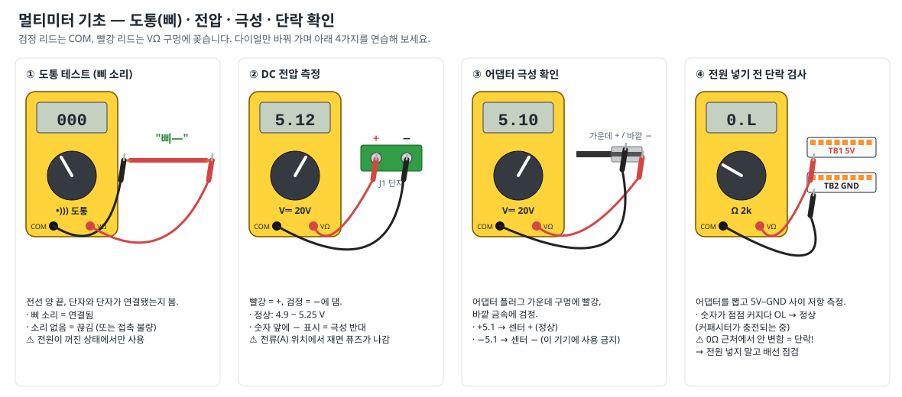

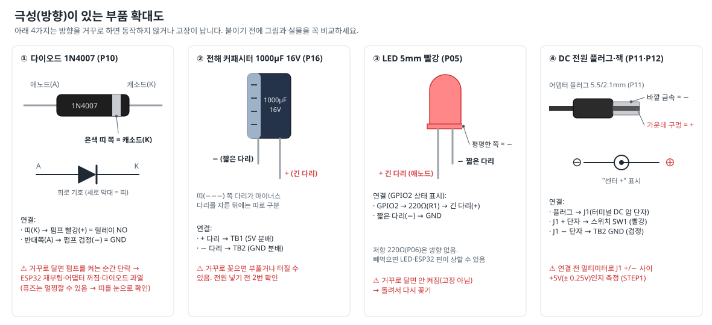

#### 절차

1. **부품 대조** — 2.1 표를 인쇄해 부품을 하나씩 꺼내며 수량과 외관(깨짐·휘어짐)을 확인하고 표에 체크합니다. 작은 부품(저항·다이오드·볼트)은 지퍼백에 P번호를 적어 나눠 담습니다.
   *왜?* 조립 도중 부품이 모자라면 주문·배송에 며칠이 걸립니다.
2. **번호 붙이기** — 펌프 4개, 용기 4개, 체크밸브 4개에 마스킹테이프로 1~4 번호를 붙입니다. 같은 번호끼리 한 세트가 됩니다.
3. **멀티미터 준비** — 검정 리드를 **COM**, 빨강 리드를 **VΩ** 구멍에 꽂습니다. (A·mA 구멍은 쓰지 않습니다.)
4. **도통 테스트 연습(그림 5 ①)** — 다이얼을 `•)))`(삐 소리) 위치로 돌리고 두 리드 끝을 맞대 보면 "삐" 소리가 납니다. 점퍼선 한 가닥의 양 끝에 대어 삐 소리가 나는지 확인합니다.
   *왜?* 앞으로 "이 선이 저 단자에 제대로 연결됐나?"를 전원 없이 확인할 때 계속 씁니다.
5. **어댑터 전압·극성 측정(그림 5 ②③)** — J1(P12)에 어댑터 플러그를 꽂고 콘센트에 연결합니다. 다이얼을 `V⎓ 20V`(직류 전압)로 두고 빨강을 J1의 **+**, 검정을 **−** 단자에 댑니다.
   - 4.9~5.25V가 나오면 정상입니다.
   - 숫자 앞에 **−**가 나오면 J1의 +/− 표시가 반대이거나 어댑터가 "센터 −" 형입니다. J1의 표시 옆에 실제 극성을 네임펜으로 적어 둡니다.
   - 측정 후 어댑터를 콘센트에서 뽑습니다.
6. **펌프 확인** — 멀티미터를 저항(Ω, 200 또는 2k) 모드로 두고 펌프의 빨강·검정 선 사이를 잽니다. 수 Ω~수십 Ω(추정)이 나오면 정상, **OL**(무한대)이면 선이 끊긴 불량입니다. 펌프는 **물 없이 돌리지 않습니다**(공회전하면 망가짐).
7. **다이오드 확인(그림 6 ①)** — 다이얼을 다이오드(`▶|`) 모드로 두고, 빨강을 띠 없는 쪽(애노드), 검정을 띠 쪽(캐소드)에 대면 0.5~0.7 정도가 나옵니다. 반대로 대면 OL. 4개 모두 확인합니다.
8. **릴레이 모듈 살펴보기 · NO/NC 확인(전원 없이)** — 입력 핀(`GND IN1 IN2 IN3 IN4 VCC`), 옆의 2핀 점퍼(보드 인쇄 `JD-VCC`·`VCC`, 작은 플라스틱 점퍼 캡이 두 핀을 잇고 있음 — 캡 색은 제품마다 다름), 출력 나사 단자에 인쇄된 **NO / COM / NC** 순서를 확인해 사진으로 찍어 둡니다. **JD-VCC 핀 옆에 빨간 네임펜으로 점**을 찍어 둡니다(VCC 핀과 바로 붙어 있어 헷갈리기 쉬움).
   - 멀티미터를 도통(`•)))`) 모드로 두고, 채널마다 나사 단자 3개 중 **COM(보통 가운데)** 과 나머지 두 단자를 차례로 잽니다. **COM–NC = "삐"**, **COM–NO = 소리 없음**이 정상입니다(릴레이가 꺼져 있을 때는 COM과 NC가 붙어 있기 때문). 소리가 안 난 단자 옆에 "NO"라고 적습니다. 4채널 모두 합니다.
   *왜?* 제품마다 단자 순서가 다를 수 있어서, 가이드 그림보다 **보드 인쇄와 멀티미터 결과가 정답**입니다. 펌프를 NC에 물리면 전원을 켜자마자 펌프가 계속 돕니다.
9. **ESP32 확인** — 데이터용 USB 케이블(P07)로 PC에 꽂으면 보드의 빨간 전원 LED가 켜지고, 윈도우 **장치 관리자 → 포트(COM & LPT)** 에 `Silicon Labs CP210x … (COMx)`가 보여야 합니다. 안 보이면 다른 케이블(충전 전용 케이블은 안 됨)을 쓰거나 CP210x 드라이버를 설치합니다.
10. **체크밸브 방향 확인** — 체크밸브(P31) 몸통의 **화살표(FLOW)** 방향으로 입으로 살짝 불면 바람이 통하고, 반대로는 막혀야 합니다. 불량은 예비(P31 추가 1개)로 교체합니다. 확인 후 물로 헹굽니다.
11. **튜브 확인** — 내경5 튜브(P29)를 펌프 출수구에 끼워 보아 헐겁지 않은지, 내경4 튜브(P30)가 체크밸브 바브에 끼워지는지 맞춰 봅니다(끝까지 끼우지 않아도 됨).

#### 확인 포인트

- [ ] ✔ 2.1 표의 "보유" 부품이 모두 있음, 부족한 것은 주문 목록에 적음
- [ ] ✔ 어댑터 출력 4.9~5.25V, J1의 +/− 극성 확인 및 표시
- [ ] ✔ 펌프 4개 모두 저항값 정상(OL 아님)
- [ ] ✔ 다이오드 4개 정방향 0.5~0.7, 역방향 OL
- [ ] ✔ 릴레이 4채널 모두 COM–NC "삐", COM–NO 무음 → NO 단자에 표시, JD-VCC 핀에 빨간 점
- [ ] ✔ ESP32가 PC에서 COM 포트로 인식됨
- [ ] ✔ 체크밸브 4개 모두 한쪽으로만 통함, 화살표 방향 확인

#### 흔한 실수

- ⚠ 멀티미터 빨강 리드를 **A(전류)** 구멍에 꽂은 채 전압을 재면 멀티미터 내부 퓨즈가 끊어집니다. 항상 **VΩ** 구멍.
- ⚠ 충전 전용 USB 케이블로는 PC가 ESP32를 인식하지 못합니다(전원 LED는 켜짐). 데이터 케이블인지 확인.
- ⚠ 펌프를 "돌아가나 보려고" 물 없이 전원에 연결하면 수명이 크게 줄어듭니다.

### STEP 2. 브레드보드 단위 테스트 {#step2}

> **목표**: 납땜·조립 전에 펌웨어를 올리고, 시리얼 명령으로 릴레이 4개가 "딸깍" 켜지고 꺼지는지, 펌프 1개가 물을 퍼 올리는지 확인한다. 릴레이 연결 방식(A안/B안)을 여기서 결정한다.
> **준비물**: ESP32(P01), 릴레이(P08), 어댑터(P11)+J1(P12), 브레드보드(P23), 점퍼선(P20~P22), LED(P05)+220Ω(P06), 1N4007(P10) 1개, 펌프(P09) 1개, 내경5 튜브 30cm, 물컵 2개, USB 케이블(P07), PC
> **소요 시간**: 2~3시간 (Arduino IDE 설치 포함)

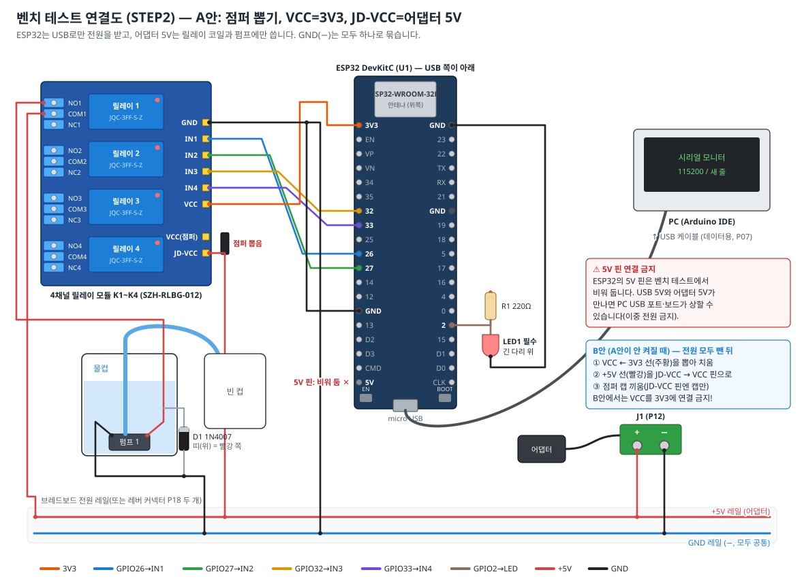

#### 절차 가. 펌웨어 업로드 (ESP32만 USB에 연결)

1. **Arduino IDE 2** 를 엽니다. 처음이라면 `../../firmware/README.md` 1장대로 설정합니다.
   - 보드 매니저: **esp32 by Espressif Systems 3.x** (검증 3.3.8). *왜?* 2.x 버전은 BLE 함수가 달라 컴파일 오류가 납니다.
   - 라이브러리 매니저: **ArduinoJson 7.x** (검증 7.4.3).
   - (이 PC에는 2026-11-06 기준 ESP32 코어 3.3.8과 ArduinoJson이 이미 설치되어 있습니다.)
2. `firmware/SmartBartender/SmartBartender.ino` 를 엽니다. `config.h`, `BartenderCore.h` 탭이 함께 열려야 합니다.
3. **도구** 메뉴: 보드 = `ESP32 Dev Module`, 포트 = STEP1에서 본 `COMx`, Partition Scheme = `Default 4MB with spiffs`.
4. ESP32**만** USB로 PC에 연결합니다(아직 다른 선은 꽂지 않음). 업로드(→) 버튼을 누릅니다.
   `Connecting....`에서 멈추면 보드의 **BOOT 버튼을 누르고 있다가** `Writing at …`이 나오면 뗍니다.
5. `Hard resetting via RTS pin...`이 나오면 완료입니다.
6. **도구 → 시리얼 모니터**: 속도 **115200**, 줄 끝 **새 줄(New Line)**. 보드의 **EN** 버튼을 누르면 `# AI 스마트 바텐더 펌웨어 v2.1.0`과 장치 이름(`SmartBartender-XXXX`)이 보입니다. 이 이름을 적어 둡니다.
7. 입력창에 `{"cmd":"hello"}` → Enter. `{"ev":"info","fw":"2.1.0",...,"calSet":[0,0,0,0],"maxPumpMs":120000,...}` 한 줄이 오면 펌웨어 정상입니다(버전 끝자리는 달라도 됨).
   `calSet`이 모두 0인 것은 "아직 캘리브레이션 안 함"이라는 뜻이라 지금은 정상입니다(STEP11에서 1로 바뀜).

#### 절차 나. 상태 LED 테스트

> **LED(P05)·220Ω(P06)이 아직 없으면**(둘 다 보유 0 — 주문품) 이 절차는 건너뛰고 절차 다·마를 먼저 한 뒤, 부품이 도착하면 돌아와서 합니다(그때는 어댑터와 USB를 모두 뽑은 상태에서 8번부터). LED는 상태 표시만 하므로 없어도 펌웨어 업로드·시리얼 명령·릴레이·펌프 시험은 똑같이 됩니다. 확인 포인트의 "외부 LED" 항목은 이때 체크합니다.

8. USB를 뽑고, 브레드보드에 **GPIO2(오른쪽 줄 15번, J3-15) → 220Ω(R1) → LED 긴 다리(+)**, **LED 짧은 다리(−) → GND(오른쪽 줄 1번, J3-1)** 로 꽂습니다(그림 7 오른쪽, 그림 6 ③). 이 LED는 **필수 부품**입니다.
9. USB를 다시 꽂으면 LED가 **1초 간격으로 천천히 깜빡**여야 합니다(= 블루투스 연결 대기 중).
   *왜 외부 LED?* 우리 보드(DevKitC V4)에는 GPIO2에 연결된 LED가 없고 빨간 전원 LED만 있기 때문입니다.

#### 절차 다. 릴레이 테스트 — A안 (SPEC 기본)

10. USB를 뽑습니다. 릴레이 모듈의 **JD-VCC 점퍼 캡을 뽑아** 잃어버리지 않게 테이프로 모듈 옆에 붙여 둡니다(B안이 되면 다시 씀).
    *왜?* 점퍼를 빼면 "입력 쪽 전원(VCC)"과 "코일 전원(JD-VCC)"이 분리됩니다. 입력 쪽을 ESP32와 같은 3.3V로 맞추면 ESP32가 HIGH(3.3V)를 낼 때 릴레이가 **확실하게 꺼집니다**.
11. 그림 7처럼 연결합니다. (F/F 또는 M/F 점퍼선 사용)
    - 릴레이 `VCC` ← ESP32 `3V3` (주황, 왼쪽 줄 맨 위 J2-1) — 빨간 점을 찍은 JD-VCC 핀이 **아닌** 쪽
    - 릴레이 `IN1` ← `GPIO26`(파랑), `IN2` ← `GPIO27`(초록), `IN3` ← `GPIO32`(노랑), `IN4` ← `GPIO33`(보라) — 연결표 ⑫~⑮와 같은 색
    - 릴레이 `GND` ← ESP32 `GND`(왼쪽 줄 14번 J2-14), 그리고 브레드보드 **GND 레일(−)**
    - 릴레이 `JD-VCC`(빨간 점 찍은 핀) ← 브레드보드 **+5V 레일** (빨강 점퍼선 — B안이 되면 이 선을 `VCC` 핀으로 옮김, 절차 라)
    - J1 `+` → +5V 레일, J1 `−` → GND 레일 (STEP1에서 표시한 실제 극성대로, J1에는 어댑터 플러그)
    - **ESP32의 `5V` 핀은 비워 둡니다.**
12. 연결을 그림 7과 한 줄씩 대조합니다. 어댑터를 꽂기 전에 멀티미터 저항 모드로 **+5V 레일–GND 레일**이 0Ω 근처가 아닌지 확인합니다(벤치에는 퓨즈가 없음). 그다음 ESP32 USB를 꽂고 → 어댑터를 콘센트에 꽂습니다.
13. 시리얼 모니터에 `{"cmd":"run","p":1,"ms":2000}` → 릴레이 1이 **"딸깍"** 하고 표시 LED가 2초간 켜졌다가 꺼져야 합니다. `p`를 2, 3, 4로 바꿔 반복합니다.
14. `{"cmd":"clean","ms":1000}` → 릴레이 1→2→3→4가 1초씩 차례로 딸깍거립니다.
15. 결과를 아래 표에 기록합니다.

| 채널 | 딸깍 소리 | 표시 LED | 꺼질 때 확실히 꺼짐 | 판정 |
|---|---|---|---|---|
| 1 (GPIO26) | [ ] | [ ] | [ ] | A안 / B안 |
| 2 (GPIO27) | [ ] | [ ] | [ ] | A안 / B안 |
| 3 (GPIO32) | [ ] | [ ] | [ ] | A안 / B안 |
| 4 (GPIO33) | [ ] | [ ] | [ ] | A안 / B안 |

#### 절차 라. (A안이 안 될 때만) B안

16. A안에서 표시 LED가 희미하거나, 딸깍 소리가 안 나거나, 4채널 중 일부만 될 때는 입력 전류가 부족한 것입니다(이 보드는 입력이 LED 두 개 직렬 구조로 보여 3.3V에서 약 0.3~0.7mA밖에 안 흐를 수 있음 — 추정). 이때 SPEC의 **공식 대체안인 B안**으로 바꿉니다.
17. **어댑터와 USB를 모두 뽑습니다.** 그다음 순서를 지킵니다(회로도.html "⑤ B안"과 같음).
    1. 릴레이 `VCC` ← ESP32 `3V3` 선(주황, 연결표 ⑪)을 **먼저 뽑아** 치웁니다.
    2. 릴레이 `JD-VCC`(빨간 점)에 꽂혀 있던 **+5V 선(빨강, 연결표 ⑨)을 뽑아, 방금 비운 입력 헤더 `VCC` 핀에 꽂습니다.**
    3. 그다음 **점퍼 캡을 끼웁니다.** JD-VCC 핀에는 캡만 남습니다. 이제 `VCC`로 들어온 +5V가 점퍼를 통해 `JD-VCC`(코일)에도 들어갑니다(VCC = JD-VCC = 5V).
    4. IN1~IN4(GPIO 직결)·GND는 그대로 둡니다.
    5. (전원 없이) 멀티미터 도통 모드로 **+5V 레일 ↔ 릴레이 `VCC` 핀**, **+5V 레일 ↔ `JD-VCC` 핀**이 모두 "삐"인지 확인합니다.

    *왜 +5V 선을 옮기나?* 점퍼 헤더는 `VCC`·`JD-VCC` 2핀뿐이고 점퍼 캡은 두 핀을 모두 덮습니다. 그래서 듀폰 선이 꽂힌 핀에는 캡이 들어가지 않고, +5V 선만 빼고 캡을 끼우면 릴레이에 5V가 전혀 들어가지 않습니다.
    *왜 이 순서?* 점퍼와 ⑪(3V3)이 한순간이라도 함께 연결되면 5V가 ESP32의 3.3V 쪽으로 거꾸로 들어가 보드가 상할 수 있습니다. +5V 선이 `VCC` 핀을 차지하면 3V3 선을 다시 꽂을 자리도 없어집니다.
18. 12~15를 다시 합니다. B안에서는 특히 **꺼질 때 표시 LED가 완전히 꺼지는지**도 봅니다. **B안에서는 릴레이 VCC를 절대 3V3에 연결하지 않습니다.** 두 안 모두 LOW = 켜짐(Active-LOW)이라 **펌웨어는 바꾸지 않습니다**.
19. 결정한 방식(A안/B안)을 릴레이 모듈에 테이프로 적어 둡니다. STEP5에서 이 방식대로 배선합니다(B안이면 연결표 ⑪은 연결하지 않고, ⑨를 입력 헤더 `VCC` 핀에 꽂은 뒤 캡을 끼움).

#### 절차 마. 펌프 1개 물 테스트

20. 어댑터를 뽑습니다. 펌프 1의 **빨강 선 → 릴레이 `NO1`(K1 NO — STEP1에서 "NO"라고 적은 단자)**, **검정 선 → GND 레일**, 릴레이 `COM1`(K1 COM) ← +5V 레일. 펌프 리드가 짧으면 악어클립 점퍼나 M/M 점퍼선을 씁니다.
21. 다이오드 1개를 펌프와 나란히 붙입니다: **띠 쪽 → 빨강(+)**, 반대쪽 → 검정(−) (그림 7 D1). 브레드보드나 악어클립으로 임시 연결합니다.
    *왜?* 모터를 끄는 순간 생기는 높은 역전압(역기전력)을 다이오드가 흘려보내 릴레이 접점과 ESP32를 보호합니다.
    ⚠ 방향을 반대로 달면 릴레이가 켜지는 순간 +5V와 GND가 다이오드로 바로 이어집니다(단락) — 어댑터가 꺼졌다 켜졌다 하고 다이오드가 뜨거워집니다. 벤치에는 퓨즈가 없으니 꽂기 전에 띠 위치를 한 번 더 봅니다.
22. 펌프 출수구에 내경5 튜브 30cm를 끼우고, 펌프를 물컵 바닥에 놓고, 튜브 끝을 빈 컵에 넣습니다.
23. USB → 어댑터 순으로 전원을 넣고 `{"cmd":"run","p":1,"ms":3000}` → 3초간 물이 나오면 성공입니다.
24. (참고 측정) 빈 컵을 비우고 `{"cmd":"run","p":1,"ms":10000}` → 나온 양을 계량컵으로 잽니다. 체크밸브 없이 약 100~140ml(10~14 ml/초, 추정) 정도면 정상입니다. 값을 적어 둡니다.
25. `{"cmd":"run","p":1,"ms":20000}` 을 보내고 5초 뒤 `{"cmd":"stop"}` → 바로 멈추고 `stopped` 이벤트가 와야 합니다(비상정지 확인).

#### 절차 바. (선택) 버튼·부저 테스트

26. 버튼(P03) 한쪽 단자 → GPIO4(오른쪽 줄 13번, J3-13), 다른 쪽 → GND. 버튼은 방향이 없지만, 단자가 3개 이상이면 멀티미터 도통 모드로 **버튼을 누를 때만 "삐"** 나는 두 단자를 고릅니다(나머지는 버튼 조명용일 수 있음). 대기 중 짧게 누르면 시리얼에 `{"ev":"status",...}`가 나옵니다. 펌프를 20초 돌리는 중에 누르면 즉시 멈추고 `"reason":"button"`이 나옵니다.
27. 부저(P04): 모듈에 인쇄된 핀 이름을 보고 `VCC → 3V3`, `GND → GND`, `I/O → GPIO23`(오른쪽 줄 2번, J3-2). ONE005는 **I/O가 HIGH일 때 울리는** 모듈이라 펌웨어 기본값(`config.h`의 `BUZZER_ON_LEVEL 1`, SPEC §1)과 맞습니다. EN 버튼을 누르면 부팅 때 "삑" 소리가 나야 합니다. 다른 부저로 바꿨는데 부팅 후 계속 울린다면 LOW에 울리는 모듈이니 `BUZZER_ON_LEVEL`을 0으로 바꿉니다.

#### 확인 포인트

- [ ] ✔ `hello` → `info` 응답, 장치 이름 기록: `SmartBartender-______`
- [ ] ✔ 외부 LED가 천천히 깜빡임
- [ ] ✔ 릴레이 4채널 모두 켜지고 꺼짐, 방식 결정: **A안 / B안** (동그라미)
- [ ] ✔ 펌프 1 물 테스트 성공, 10초 유량 ______ ml (체크밸브 없음)
- [ ] ✔ `stop` 명령으로 즉시 정지

#### 흔한 실수

- ⚠ 어댑터 +5V를 ESP32 `5V` 핀에도 연결 → USB와 이중 전원. 벤치 테스트에서 ESP32는 **USB로만** 전원을 받습니다.
- ⚠ GND를 공통으로 묶지 않음 → 릴레이가 반응하지 않습니다. ESP32 GND, 릴레이 GND, 어댑터 −가 모두 GND 레일에 있어야 합니다.
- ⚠ 830 브레드보드 한 개에 ESP32를 꽂으면 보드가 넓어 한쪽 핀 열을 쓸 수 없습니다. 브레드보드 2개를 나란히 붙여 걸쳐 꽂거나, ESP32 핀에 F 점퍼선을 직접 꽂으세요.
- ⚠ 시리얼 모니터의 줄 끝이 "줄 끝 없음"이면 명령이 실행되지 않습니다. **새 줄(New Line)** 로.
- ⚠ 업로드 중에는 시리얼 모니터 창이 포트를 잡고 있으면 실패할 수 있습니다. 업로드 실패 시 모니터를 닫고 다시.

### STEP 3. 펌프 리드선 연장 · 납땜 · 열수축 · 다이오드 {#step3}

> **목표**: 펌프 4개 각각을 "뚜껑 + 펌프 + 70cm 연장선 + 다이오드"가 붙은 **펌프 모듈**로 만든다. 이음부는 물에 닿지 않는 뚜껑 위에, 다이오드는 젖지 않는 전장 박스 쪽 끝에 둔다.
> **준비물**: 펌프(P09) 4, 용기(P32) 4, AWG20 2심(P19) 약 3m, 솔더 슬리브(P25) 8, 1N4007(P10) 4, 수축튜브(P26), 인두(P46)·실납(P47), 열풍기(P52), 스트리퍼(P49)·니퍼(P50), 스텝드릴(P53)·송곳, 글루건, 마스킹테이프
> **소요 시간**: 2~3시간

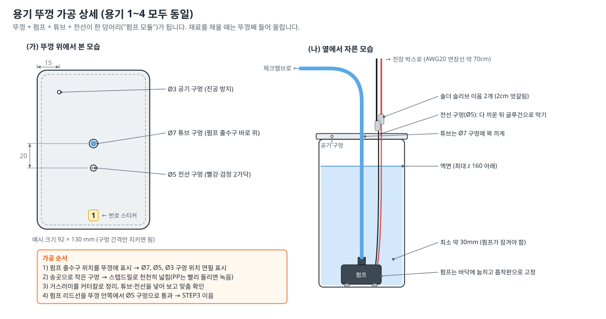

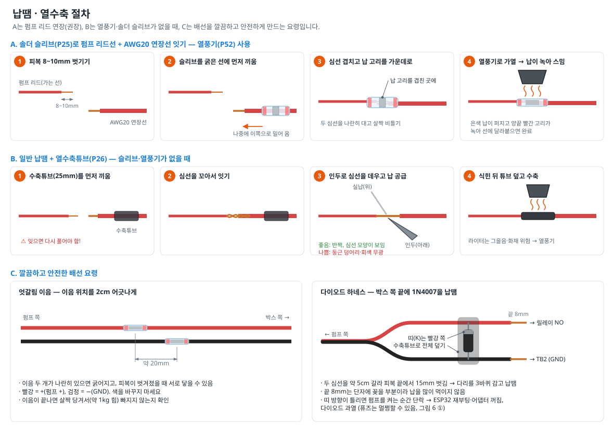

#### 절차

1. **연장선 자르기** — AWG20 2심을 **70cm × 4가닥**으로 자릅니다. 양 끝에 펌프 번호(1~4) 테이프를 붙이고, 한쪽 끝에는 "펌프 쪽", 다른 쪽에는 "박스 쪽"이라고 씁니다.
   *왜 70cm?* 용기 바닥 → 뚜껑 → 선반 구멍 → 박스까지 약 40cm에, 용기를 뒤로 30cm 꺼낼 수 있는 여유를 더한 길이입니다. 실제 배치에서 남으면 묶어 두면 됩니다.
2. **다이오드 하네스(박스 쪽 끝) 먼저 만들기(그림 9 C 오른쪽)**
   1. 박스 쪽 끝의 빨강·검정을 약 5cm 갈라 놓고, 각각 피복을 **15mm** 벗깁니다.
   2. 다이오드의 **띠(캐소드) 쪽 다리를 빨강**, 반대쪽 다리를 **검정** 심선에 피복 가까운 곳부터 3바퀴 감습니다. 감기 전에 두 심선에 수축튜브(다이오드 길이 + 1cm)를 미리 한 개씩 끼워 둡니다.
   3. 감은 부분만 납땜합니다. 심선의 **끝 8mm에는 납을 많이 먹이지 않습니다**(나중에 단자에 꽂는 부분).
   4. 남는 다이오드 다리를 자르고, 수축튜브를 다이오드·납땜부 위로 덮어 열풍기로 수축합니다.
   5. **바로 확인**: 멀티미터 다이오드 모드로 **검정 리드 → 빨강 선 끝, 빨강 리드 → 검정 선 끝**에 대면 0.5~0.7, 반대로 대면 OL이어야 합니다.
   *왜 먼저?* 펌프를 연결하면 펌프 코일이 다이오드와 나란히 붙어 멀티미터로 방향을 확인할 수 없습니다. 펌프를 잇기 전에 확인해야 합니다.
   *왜 박스 쪽?* 다이오드와 납땜부가 액체·습기에 닿지 않는 곳에 있어야 오래갑니다. SPEC §1은 다이오드 위치를 "펌프 리드선 이음부(뚜껑 위) 또는 연장선의 박스 쪽 끝 — **전기적으로 동일**"이라고 정해 두었습니다. 배선도(wiring.svg)는 이음부 쪽으로 그렸지만, 어느 쪽이든 펌프와 **병렬**이고 **띠 = 빨강(+)** 이면 똑같이 동작합니다.
3. **뚜껑 가공(그림 8)** — 용기 안에 펌프를 놓아 보고, 출수구 바로 위 뚜껑에 **Ø7 튜브 구멍**, 그 옆 20mm에 **Ø5 전선 구멍**, 가장자리 15mm 안쪽에 **Ø3 공기 구멍**을 연필로 표시합니다.
   - 송곳으로 작은 구멍을 낸 뒤 스텝드릴을 **천천히** 돌려 넓힙니다. *왜?* PP 뚜껑은 빨리 돌리면 열로 녹아 구멍이 지저분해집니다.
   - *왜 공기 구멍?* 밀폐용기는 액체를 퍼낼수록 안이 진공이 되어 유량이 줄어듭니다. 작은 구멍 하나로 공기가 들어오게 합니다(SPEC §1). **Ø3 공기 구멍은 글루건으로 막지 않습니다.**
   - 거스러미는 커터칼로 정리합니다. 4개 모두 같은 위치로 가공합니다.
4. **펌프 리드선 통과** — 펌프의 빨강·검정 리드선을 뚜껑 **안쪽에서 바깥쪽으로** Ø5 구멍에 통과시킵니다. 펌프 리드가 뚜껑 위로 최소 3cm 나와야 합니다.
   - 리드가 짧아 뚜껑 위로 나오지 않으면: 뚜껑 안쪽에서 잇고, 이음부를 솔더 슬리브(접착제 내장이라 방수)로 확실히 감싼 뒤 액면보다 높은 곳(뚜껑 바로 아래)에 오게 합니다.
5. **이음(그림 9 A — 솔더 슬리브, 권장)**
   1. 펌프 리드와 연장선(펌프 쪽 끝)의 피복을 각각 **8~10mm** 벗깁니다. 빨강·검정의 이음 위치가 **2cm 엇갈리도록** 연장선의 빨강과 검정 길이를 2cm 다르게 자릅니다(그림 9 C 왼쪽).
      *왜?* 두 이음이 나란히 있으면 굵어지고, 혹시 피복이 벗겨졌을 때 서로 닿아 단락될 수 있습니다.
   2. 솔더 슬리브(P25)를 굵은 연장선 쪽에 먼저 끼웁니다.
   3. 두 심선을 나란히 겹쳐 살짝 비틀고, 슬리브를 밀어 와서 **가운데 은색 납 고리가 겹친 곳 한가운데** 오게 합니다.
   4. 열풍기(약 250~300℃ 또는 1단)를 슬리브 가운데부터 쬡니다. 은색 납이 녹아 심선 사이로 스미고, 양 끝 빨간 접착 고리가 녹아 선에 달라붙으면 끝입니다(약 20~40초).
   5. 식힌 뒤 양쪽을 살짝(약 1kg 힘) 당겨 빠지지 않는지 봅니다.
   - **열풍기가 없으면 그림 9 B**: 수축튜브를 먼저 끼우고 → 심선을 꼬아 잇고 → 인두로 심선을 3초 데운 뒤 실납을 심선에 대어 녹이고(인두 끝에 직접 녹이지 않음) → 식힌 뒤 수축튜브를 덮어 열풍기나 인두 옆면으로 수축합니다.
6. **색 확인** — 펌프 빨강 ↔ 연장선 빨강, 펌프 검정 ↔ 연장선 검정인지 다시 봅니다. 판매처 안내대로 **빨강 = +**입니다.
7. **전선 구멍 막기** — 뚜껑 안쪽에서 펌프 리드를 1~2cm 당겨 여유를 두고, 뚜껑 위 Ø5 구멍 둘레를 글루건으로 막습니다(전선이 빠지지 않게 + 물방울 차단). Ø7 튜브 구멍은 STEP8에서 튜브를 끼운 뒤 마무리합니다. Ø3 공기 구멍은 그대로 둡니다.
8. **동작 확인** — STEP2의 벤치 연결에서 펌프 모듈의 박스 쪽 끝을 **빨강 → NO1, 검정 → GND 레일**에 꽂고, 펌프를 물컵에 넣은 채 `{"cmd":"run","p":1,"ms":2000}`. 물이 나오면 성공. 4개 모두 반복합니다.

#### 확인 포인트

- [ ] ✔ 다이오드 하네스 4개 모두 다이오드 모드로 방향 확인(검정 리드→빨강 선: 0.5~0.7)
- [ ] ✔ 이음부 8곳 당김 테스트 통과, 빨강-빨강·검정-검정
- [ ] ✔ 이음부가 모두 뚜껑 **위**에 있음
- [ ] ✔ 뚜껑마다 Ø7·Ø5·Ø3 구멍 3개, 번호 스티커
- [ ] ✔ 펌프 모듈 4개 물 테스트 통과

#### 흔한 실수

- ⚠ 수축튜브·솔더 슬리브를 **미리 끼우지 않고** 납땜 → 다시 풀어야 합니다. 납땜 전에 항상 "튜브 끼웠나?"를 먼저.
- ⚠ 다이오드 방향 반대 → 펌프를 켜는 순간 5V가 다이오드로 바로 흘러(단락) ESP32가 재부팅되거나 어댑터가 꺼집니다. **퓨즈(F1)는 멀쩡할 수 있고**, ESP32를 USB로 켠 상태(STEP7 디버깅)에서는 단락이 계속돼 다이오드가 뜨거워집니다. 수축 전에 사진을 찍어 두세요.
- ⚠ 열풍기를 한곳에 너무 오래 → 피복이 녹습니다. 슬리브를 돌려 가며 고르게.
- ⚠ 납땜 덩어리가 회색·둥근 공 모양이면 "냉납"(접촉 불량). 심선을 충분히 데운 뒤 다시.

### STEP 4. 전원부 (DC 단자 · 스위치 · 퓨즈 · 분배 커넥터 · 커패시터) {#step4}

> **목표**: `어댑터 → J1 → SW1 → F1(3A) → TB1(+5V 분배)` 와 `J1(−) → TB2(GND 분배)` 를 만들고, 1000µF 커패시터 C1을 TB1–TB2 사이에 단다 (연결표 ②~⑦).
> **준비물**: J1(P12), SW1(P13), F1 퓨즈홀더(P14) + 3A 퓨즈(P15), PCT-418(P18) 2개(TB1·TB2), C1 1000µF(P16), AWG20(P19), UL1007 22AWG **검정(P62)** — ⑦용, 수축튜브(P26), 인두·실납, 멀티미터, **뒤판 G(재단된 판 410×115)** + 드릴·스텝드릴
> **소요 시간**: 2~2.5시간

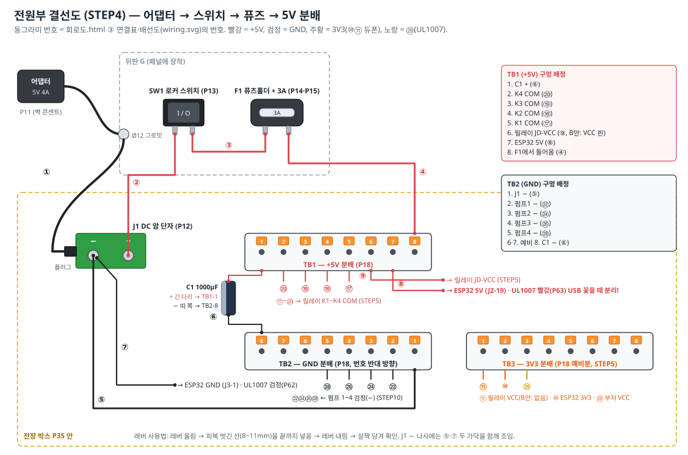

#### 레버 커넥터(PCT-418) 사용법

레버를 위로 올림 → 피복을 제품 옆면에 표시된 길이(보통 10~11mm)만큼 벗긴 선을 **끝까지** 넣음 → 레버를 내림 → 살짝 당겨 빠지지 않는지 확인. 8구는 **모두 서로 연결**되어 있어서, 한 구멍에 넣은 전기가 나머지 7구로 나눠집니다("전선 분배기").

#### 절차

1. **SW1·F1 구멍 크기 재기** — 로커 스위치(P13)의 몸통 크기(보통 약 19×13mm, 추정)와 퓨즈홀더(P14)의 나사 몸통 지름(보통 Ø12~13mm, 추정)을 캘리퍼스나 자로 재서 적어 둡니다.
2. **뒤판 G에 구멍 내기(먼저!)** — 재단된 G판에 [STEP9 구멍 표](#step9)의 **G 행**대로 Ø12(어댑터 선)·사각(SW1)·둥근 구멍(F1, 1에서 잰 지름)을 뚫습니다. 사각 구멍 맞추는 법과 "뒤(바깥)" 표시는 STEP9 절차 나를 따릅니다.
   *왜 지금?* 스위치(SW1)와 퓨즈홀더(F1)는 **G 바깥에서 구멍에 끼우는** 부품입니다. 둘을 잇는 짧은 선 ③을 먼저 납땜해 버리면, 한쪽을 끼운 뒤 다른 쪽을 G 바깥으로 꺼낼 길이 없어 **둘 다 끼우는 것이 불가능**합니다(③을 다시 떼어야 함). 그래서 G에 먼저 끼운 다음 G 안쪽에서 납땜합니다.
   - G판이 아직 없으면(재단 주문 배송 중) STEP3이나 STEP9 준비를 먼저 하고, 판이 오면 STEP4를 합니다. **SW1·F1은 G에 끼우기 전에 납땜하지 않습니다.**
3. **SW1·F1을 G에 끼우기** — G의 바깥면("뒤(바깥)"이라고 쓴 면)에서 SW1을 사각 구멍에 밀어 "딸깍" 끼웁니다. F1은 바깥에서 둥근 구멍에 넣고 **G 안쪽에서 고정 너트를 조입니다.** 아직 선은 없습니다.
4. **SW1 납땜(G 안쪽)** — 빨강 AWG20 두 가닥(② 약 25cm, ③ 약 8cm)을 준비합니다. 스위치 단자에 맞는 수축튜브를 먼저 끼우고, 단자 구멍에 심선을 걸어 납땜한 뒤 수축튜브로 단자를 덮습니다. 인두 끝이 G판(포맥스)에 닿지 않게 합니다(녹음).
   *왜 수축튜브?* 스위치 단자는 금속이 드러나 있어 다른 선이나 금속 꺾쇠에 닿으면 단락됩니다.
5. **F1 납땜(G 안쪽)** — ③의 다른 끝을 퓨즈홀더 한쪽 단자에, 빨강 ④(약 30cm)를 다른 쪽 단자에 납땜하고 수축튜브로 덮습니다. ③은 G 안쪽에서만 지나갑니다.
   *왜 이 순서(스위치 → 퓨즈)?* 스위치를 끄면 퓨즈 이후 전체가 꺼지고, 퓨즈는 스위치 뒤의 모든 배선을 보호합니다.
   - 이제 G판은 ②·④로 전원부에 매달린 채 STEP9까지 함께 다닙니다(그림 10의 "뒤판 G" 점선 상자). STEP9에서 G를 본체에 붙일 때 ②·④의 박스 쪽 끝을 잠시 빼고, STEP10에서 다시 연결합니다.
6. **J1 연결** — J1(P12) 나사 단자를 일자드라이버로 풉니다. 피복을 6~7mm 벗긴 **② 빨강 → J1 +** 에 넣고 조입니다. **J1 −** 에는 **⑤ 검정 AWG20(약 15cm)** 과 **⑦ 검정 UL1007(P62, 약 20cm, 나중에 ESP32 GND로 감)** 두 가닥을 함께 꼬아 넣고 조인 뒤 당겨 봅니다. STEP1에서 표시한 실제 극성을 따릅니다.
   *왜 J1 −에서 바로 ESP32로?* 펌프의 큰 전류가 흐르는 GND(TB2)와 ESP32의 GND를 J1 한 점에서 나눠, 펌프가 켜질 때 생기는 잡음이 ESP32로 덜 들어가게 합니다(SPEC §1 **별형 접지**, 회로도 ⑤·⑦). 릴레이 GND는 STEP5에서 ESP32 GND에 연결합니다(⑯). 결국 모든 GND는 하나로 이어집니다.
7. **TB1 (+5V)** — ④ 끝 → **TB1 8번** 구멍.
8. **TB2 (GND)** — ⑤ 끝 → **TB2 1번** 구멍. (TB3는 STEP5에서 **3V3 분배**용으로 씁니다.)
9. **C1 커패시터(그림 6 ②)** — 두 다리를 각각 수축튜브로 감싸 끝 10mm만 드러내고, **긴 다리(+) → TB1 1번**, **띠 쪽 짧은 다리(−) → TB2 8번** 에 꽂습니다(⑥). TB2를 TB1 아래에 **반대 방향**으로 놓으면 TB1-1과 TB2-8이 위아래로 마주 보아 다리를 바로 꽂을 수 있습니다(그림 10).
   *왜?* 펌프가 켜지는 순간 큰 전류가 흘러 5V가 순간적으로 떨어지는데, 커패시터가 작은 물탱크처럼 전기를 보충해 ESP32가 재부팅(브라운아웃)되는 것을 막습니다.
10. **퓨즈 넣기** — 퓨즈홀더 뚜껑을 돌려 열고 3A 퓨즈(P15)를 넣습니다. 예비 퓨즈 2개는 예비 부품 상자([5장](#s5))에 넣어 둡니다.
11. **단락 검사(그림 5 ④)** — 어댑터를 뽑은 상태에서 멀티미터 저항 모드로 TB1–TB2 사이를 잽니다. 숫자가 점점 커져 OL이 되면 정상(커패시터가 충전되는 중)입니다. 0Ω 근처에서 그대로면 어딘가 단락입니다.
12. **전압 확인** — SW1을 OFF로 두고 어댑터를 꽂습니다. TB1–TB2: **0V** → SW1 ON: **4.9~5.25V** → 퓨즈를 빼면 0V → 다시 넣기. 확인 후 SW1 OFF, 어댑터 뽑기.

#### 확인 포인트

- [ ] ✔ SW1·F1이 G에 **먼저 끼워진 뒤** 납땜됨, ③은 G 안쪽에만 있음
- [ ] ✔ SW1 OFF → 0V, ON → 약 5V (TB1–TB2)
- [ ] ✔ C1 + 는 TB1, − 는 TB2 (띠 쪽)
- [ ] ✔ 모든 금속 단자가 수축튜브로 덮여 있음
- [ ] ✔ 레버 커넥터 선 당김 테스트 통과
- [ ] ✔ SW1·F1 구멍 실측값 기록: SW1 ____×____ mm, F1 Ø____ mm

#### 흔한 실수

- ⚠ SW1·F1을 G에 끼우기 전에 ③까지 납땜 → 둘을 G에 끼울 수 없습니다(바깥에서 끼우는 부품 두 개가 선으로 이어져 있기 때문). ③ 한쪽을 인두로 떼고 G에 끼운 뒤 다시 납땜하세요.
- ⚠ 피복을 너무 짧게 벗겨 레버 커넥터 안에서 피복이 물림 → 접촉 불량. 너무 길면 심선이 밖으로 드러나 단락 위험.
- ⚠ 퓨즈가 끊어졌다고 더 큰 퓨즈나 은박지로 바꾸기 → 단락 시 화재 위험. 원인(다이오드 방향, 선 닿음)을 먼저 찾으세요.
- ⚠ 한 레버 구멍에 선 두 개를 억지로 꽂기 → 한 구멍에 한 선이 원칙입니다(두 가닥을 함께 조이는 곳은 J1 − 나사뿐).

### STEP 5. ESP32 · 릴레이 영구 배선 (연결표) {#step5}

> **목표**: 전장 박스(P35) 안에 ESP32+확장보드, 릴레이, 분배 커넥터를 고정하고, 아래 **연결표 순서 그대로**(⑦~⑳) 영구 배선한다. STEP2에서 정한 A안/B안을 따른다.
> **준비물**: 전장 박스(P35), ESP32(P01)+확장보드(P02), 릴레이(P08), STEP4 전원부, M3 서포트(P39) 4 + M3×6(P40) 8, 점퍼선 F/F(P20)·M/F(P21), AWG20(P19), UL1007 빨강(P63, ⑧)·노랑(P24, ⑩을 UL1007로 할 때), 레버 커넥터 1개 더(TB3, 3V3용), 100µF(P17, 선택), 접착 마운트(P28), 케이블타이(P27), 스텝드릴, 마스킹테이프
> **소요 시간**: 3~4시간

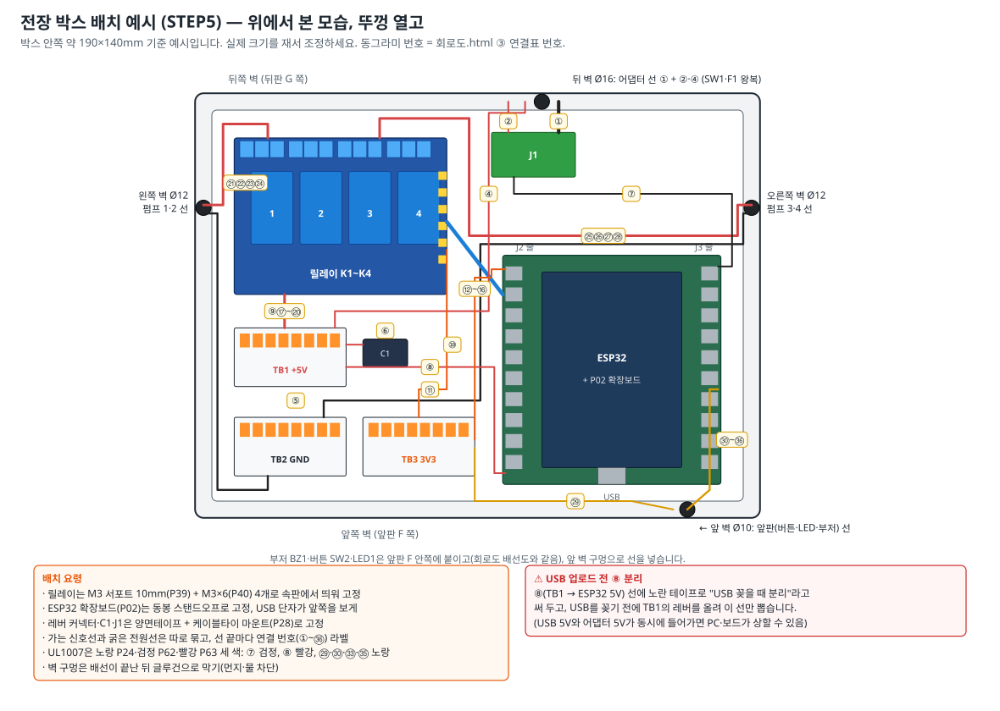

> 실물 배선 그림은 `../circuit/wiring.svg`, 전기 회로는 `../circuit/schematic.svg`, 원본 연결표는 `../circuit/회로도.html` "③ 연결표"입니다. 아래 표는 그 연결표를 **같은 번호(①~㊱)** 로 옮기고, 이 가이드의 STEP과 대략 길이를 덧붙인 것입니다.

#### 절차 가. 박스 준비

1. 박스의 안쪽 크기(가로·세로·높이)와 속판 크기를 재서 적고, 부품들을 속판 위에 올려 그림 11처럼 배치해 봅니다. 겹치면 조정합니다.
2. **벽 구멍** — 스텝드릴로 뚫습니다. 왼쪽 벽 Ø12(펌프 1·2), 오른쪽 벽 Ø12(펌프 3·4), 뒤 벽 Ø16(어댑터 선 ①, SW1·F1 왕복선 ②·④), 앞 벽 Ø10(앞판의 버튼·LED·부저 선 ㉙~㊱). 높이는 박스 바닥에서 약 20mm.
   - 뒤 벽 구멍으로는 STEP10에서 **어댑터 플러그 머리**가 지나가야 합니다. 플러그 머리 지름을 재서 Ø16보다 크면 구멍을 더 넓힙니다.
   - 박스 **바닥에는 구멍을 뚫지 않습니다**(STEP10에서 벨크로로 고정). 볼트 고정(선택, M3×15 P68 + 너트 P38)을 고른 경우만, 이때(속판을 달기 전) 바닥 **뒤쪽 두 모서리**에 Ø3.5를 뚫습니다(STEP10 절차 1).
   *왜?* 선반 구멍(x 60, x 360)이 박스 양옆에 있고, 전원 부품은 뒤판 G, 버튼·LED는 앞판 F에 있기 때문입니다(그림 4 (다)).
3. **릴레이 고정** — 릴레이의 고정 구멍(Ø3, 간격 약 69.6 × 49.4mm)에 맞춰 속판에 Ø3.2 구멍 4개를 뚫고, M3 서포트 10mm(P39)를 아래에서 M3×6(P40)으로 고정 → 릴레이를 올리고 위에서 M3×6으로 고정합니다.
   *왜 띄우나?* 릴레이 뒷면의 납땜 점이 다른 금속에 닿지 않게 하고, 열이 빠지게 합니다.
4. **ESP32 + 확장보드(P02)** — 확장보드를 동봉 스탠드오프로 속판에 고정하고, ESP32를 확장보드 소켓에 핀 이름이 맞게 꽂습니다(보드의 `3V3`이 확장보드의 `3V3` 표시와 같은 자리). **USB 단자가 박스 앞쪽**을 보게 둡니다.
5. **TB1~TB3, C1, J1** — 양면테이프(폼형)로 붙이고, 필요하면 접착 마운트(P28)+케이블타이로 한 번 더 잡습니다. 넣기 전에 ②(J1 +)·④(TB1-8)를 잠시 빼서, G에 달린 쪽 끝이 박스 밖에 남도록 **박스 뒤 벽 Ø16 구멍으로 바깥→안으로** 넣은 뒤 다시 연결합니다.
6. **A안이면 릴레이 JD-VCC 점퍼 캡을 뽑습니다.** **B안이면**(이 STEP은 전원 없이 배선) 아래 연결표의 ⑪은 **연결하지 않고**, ⑨(+5V)를 JD-VCC 핀이 아닌 **입력 헤더 `VCC` 핀**에 꽂은 뒤 점퍼 캡을 끼웁니다(JD-VCC 핀에는 캡만).
   *왜?* 점퍼 헤더는 2핀이라 캡이 두 핀을 모두 덮습니다. 선이 꽂힌 핀에는 캡이 들어가지 않고, ⑨를 빼고 캡만 끼우면 릴레이에 5V가 들어가지 않습니다.

#### 절차 나. 배선 요령

7. 연결표 순서대로 **한 줄씩** 연결하고, 끝날 때마다 표의 □에 체크합니다. 선 양 끝에 번호 테이프(⑦, ⑧ …)를 붙입니다. 선 색은 아래 표의 색(= 회로도 배선도의 색)을 따르면 나중에 찾기 쉽습니다.
   - **UL1007 22AWG는 노랑(P24)·검정(P62)·빨강(P63) 세 색만 삽니다.** GND선(⑦, 앞판 GND 공통선 ㉛·㉜·㉞·㊱)은 검정, ESP32 5V선(⑧)은 빨강, 그 밖의 UL1007 선(⑩을 UL1007로 할 때, ㉙·㉚·㉝·㉟)은 모두 노랑입니다.
   - *왜?* ⑦(GND)과 ⑧(5V)을 바꿔 물면 ESP32에 거꾸로 전기가 들어가 고장 나므로 색으로 확실히 나눕니다. 노랑 선은 여러 가닥이 같은 색이라 **양 끝 번호 테이프가 유일한 구분 방법**입니다. 자르자마자 번호를 붙이세요.
8. **릴레이 입력 헤더 ↔ 확장보드**: F/F 점퍼선의 한쪽 끝(암 소켓)은 릴레이 핀에 꽂고, 다른 쪽 끝을 잘라 피복을 8mm 벗겨 꼬은 뒤 확장보드 푸시인 단자에 넣습니다. 소켓이 헐거우면 글루건 한 방울로 고정합니다.
9. **릴레이 나사 단자**: 피복 6~7mm, 일자드라이버로 단자를 풀고 넣은 뒤 조이고 당겨 봅니다.
10. 3V3은 **TB3(레버 커넥터)** 에서 나눕니다: ESP32 3V3 → TB3-2(⑩), TB3-1 → 릴레이 VCC(⑪), TB3-3 → 부저 VCC(㉙). ESP32의 GND 단자는 J3-1(⑦), J2-14(⑯), J3-7(㉛)을 하나씩 씁니다.

#### 연결표 (①~㊱ — 회로도.html ③ 연결표와 같은 번호) {#wiring-table}

| □ | 번호 | 출발 | 도착 | 선 (색 · 대략 길이) | STEP | 비고 |
|:-:|:-:|---|---|---|:-:|---|
| [ ] | ① | 어댑터 DC 플러그 | J1 DC잭(암) | (꽂기) | 10 | 뒤판 G의 Ø12 구멍(그로밋) → 박스 뒤 벽 구멍 통과, 장력 완화 묶음 |
| [ ] | ② | J1 **+** 나사 | SW1 단자 1 | AWG20 빨강 25cm | 4 | 박스 뒤 벽 구멍 통과. STEP9에서 J1 쪽을 빼고 STEP10에서 다시 연결 |
| [ ] | ③ | SW1 단자 2 | F1 단자 1 | AWG20 빨강 8cm | 4 | 납땜 + 수축튜브 (뒤판 G 안쪽) |
| [ ] | ④ | F1 단자 2 | **TB1-8** | AWG20 빨강 30cm | 4 | 박스 뒤 벽 구멍 통과. STEP9에서 TB1 쪽을 빼고 STEP10에서 다시 연결 |
| [ ] | ⑤ | J1 **−** 나사 | **TB2-1** | AWG20 검정 15cm | 4 | J1 − 나사에 ⑤·⑦ 함께 조임 |
| [ ] | ⑥ | C1 긴 다리(+) / 띠 다리(−) | **TB1-1** / **TB2-8** | 부품 다리 | 4 | 극성 반대 금지 |
| [ ] | ⑦ | J1 **−** 나사 | ESP32 **GND** (J3-1) | UL1007 검정(P62) 20cm | 4·5 | ESP32 쪽 GND (별형 접지) |
| [ ] | ⑧ | **TB1-7** | ESP32 **5V** (J2-19) | UL1007 빨강(P63) 20cm | 5 | 노란 테이프 "USB 꽂을 때 분리" |
| [ ] | ⑨ | **TB1-6** | A안: 릴레이 **JD-VCC** 핀 (빨간 점) / **B안: 입력 헤더 VCC 핀**(⑪ 자리) | 듀폰 F 빨강 | 5 | A안: 점퍼 캡 빼서 보관 / B안: ⑨를 VCC 핀에 꽂고 캡 끼움 — JD-VCC 핀에는 캡만 |
| [ ] | ⑩ | ESP32 **3V3** (J2-1) | **TB3-2** | 듀폰 주황(양 끝을 잘라 씀) 또는 UL1007 노랑(P24) + 번호 테이프 ⑩, 약 15cm | 5 | 3V3선. 노랑으로 하면 번호 테이프로만 구분 |
| [ ] | ⑪ | 릴레이 **VCC** 핀 | **TB3-1** | 듀폰 F 주황 | 5 | **B안이면 연결하지 않음**(그 VCC 핀에 ⑨가 들어감, B안에서 3V3 연결 금지) |
| [ ] | ⑫ | ESP32 **GPIO26** (J2-10) | 릴레이 **IN1** | 듀폰 파랑 | 5 | 펌프 1 |
| [ ] | ⑬ | ESP32 **GPIO27** (J2-11) | 릴레이 **IN2** | 듀폰 초록 | 5 | 펌프 2 |
| [ ] | ⑭ | ESP32 **GPIO32** (J2-7) | 릴레이 **IN3** | 듀폰 노랑 | 5 | 펌프 3 |
| [ ] | ⑮ | ESP32 **GPIO33** (J2-8) | 릴레이 **IN4** | 듀폰 보라 | 5 | 펌프 4 |
| [ ] | ⑯ | 릴레이 **GND** 핀 | ESP32 **GND** (J2-14) | 듀폰 F 검정 | 5 | 릴레이 코일 전류(최대 약 0.3A)도 이 선으로 |
| [ ] | ⑰ | **TB1-5** | 릴레이 **K1 COM** | AWG20 빨강 15cm | 5 | |
| [ ] | ⑱ | **TB1-4** | 릴레이 **K2 COM** | AWG20 빨강 15cm | 5 | |
| [ ] | ⑲ | **TB1-3** | 릴레이 **K3 COM** | AWG20 빨강 15cm | 5 | |
| [ ] | ⑳ | **TB1-2** | 릴레이 **K4 COM** | AWG20 빨강 15cm | 5 | |
| [ ] | ㉑ | 릴레이 **K1 NO** | 펌프 1 빨강(+) | 펌프 모듈 연장선 빨강 | 10 | 왼쪽 벽 구멍 |
| [ ] | ㉒ | 펌프 1 검정(−) | **TB2-2** | 펌프 모듈 연장선 검정 | 10 | |
| [ ] | ㉓ | 릴레이 **K2 NO** | 펌프 2 빨강(+) | 펌프 모듈 연장선 빨강 | 10 | 왼쪽 벽 구멍 |
| [ ] | ㉔ | 펌프 2 검정(−) | **TB2-3** | 펌프 모듈 연장선 검정 | 10 | |
| [ ] | ㉕ | 릴레이 **K3 NO** | 펌프 3 빨강(+) | 펌프 모듈 연장선 빨강 | 10 | 오른쪽 벽 구멍 |
| [ ] | ㉖ | 펌프 3 검정(−) | **TB2-4** | 펌프 모듈 연장선 검정 | 10 | |
| [ ] | ㉗ | 릴레이 **K4 NO** | 펌프 4 빨강(+) | 펌프 모듈 연장선 빨강 | 10 | 오른쪽 벽 구멍 |
| [ ] | ㉘ | 펌프 4 검정(−) | **TB2-5** | 펌프 모듈 연장선 검정 | 10 | |
| [ ] | D1~D4 | 1N4007 띠(캐소드) → 펌프 빨강(+) | 반대쪽(애노드) → 펌프 검정(−) | 부품 다리 | 3 | 위치: 연장선 박스 쪽 끝(이 가이드) 또는 뚜껑 위 이음부(배선도 그림) — 전기적으로 동일 |
| [ ] | ㉙ | **TB3-3** | 부저 BZ1 VCC | UL1007 노랑(P24) 40cm + 듀폰 F 끝, 번호 테이프 ㉙ (듀폰 주황을 이어 써도 됨) | 10 | 부저를 달 때만. 3V3선 |
| [ ] | ㉚ | ESP32 **GPIO23** (J3-2) | 부저 BZ1 I/O | UL1007 노랑(P24) 40cm + 듀폰 F 끝, 번호 테이프 ㉚ | 10 | |
| [ ] | ㉛ | ESP32 **GND** (J3-7) | 앞판 GND 공통선 | UL1007 검정(P62) 40cm | 10 | 앞판 안쪽을 지나는 검정선 1가닥 |
| [ ] | ㉜ | 부저 BZ1 GND | 앞판 GND 공통선 | 듀폰 F + UL1007 검정(P62) | 9 | 공통선에 납땜 |
| [ ] | ㉝ | ESP32 **GPIO4** (J3-13) | 버튼 SW2 단자 1 | UL1007 노랑(P24) 40cm, 번호 테이프 ㉝ | 10 | 버튼은 방향 없음 |
| [ ] | ㉞ | 버튼 SW2 단자 2 | 앞판 GND 공통선 | UL1007 검정(P62) | 9 | 납땜 |
| [ ] | ㉟ | ESP32 **GPIO2** (J3-15) | R1 220Ω → LED1 긴 다리(+) | UL1007 노랑(P24) 40cm, 번호 테이프 ㉟ | 10 | R1은 LED 다리에 납땜 |
| [ ] | ㊱ | LED1 짧은 다리(−) | 앞판 GND 공통선 | UL1007 검정(P62) | 9 | 납땜 |
| [ ] | (선택) | C2 100µF + / − | 확장보드 5V / GND | 부품 다리 | 5 | 회로도 외 추가 보조(재부팅이 잦을 때만) |

**분배 커넥터 구멍 배정** (그림 10, 회로도와 같음)

| 커넥터 | 1 | 2 | 3 | 4 | 5 | 6 | 7 | 8 |
|---|---|---|---|---|---|---|---|---|
| TB1 (+5V) | C1 + (⑥) | K4 COM (⑳) | K3 COM (⑲) | K2 COM (⑱) | K1 COM (⑰) | JD-VCC (⑨) — B안: 릴레이 VCC | ESP32 5V (⑧) | F1에서 (④) |
| TB2 (GND) | J1 − (⑤) | 펌프1 − (㉒) | 펌프2 − (㉔) | 펌프3 − (㉖) | 펌프4 − (㉘) | 예비 | 예비 | C1 − (⑥) |
| TB3 (3V3) | 릴레이 VCC (⑪) — B안: 비움 | ESP32 3V3 (⑩) | 부저 VCC (㉙) | 예비 | 예비 | 예비 | 예비 | 예비 |

> 참고: 분배 커넥터 배정은 SPEC v2.1 §1·회로도(v3)와 같이 **TB1 = +5V, TB2 = GND, TB3 = 3V3**입니다(예전 자료에 "GND 2개"로 적힌 메모가 있어도 이 배정이 맞습니다). ESP32 GND는 J1 − 나사에서 바로(⑦), 다이오드는 펌프 선에 납땜하므로 GND 레버 커넥터는 TB2 하나로 충분합니다. 구매 수량(4개: 3개 사용 + 예비 1)은 그대로입니다.

#### 절차 다. 배선 후 점검 (전원 없이)

11. 멀티미터 도통 모드로 **⑫~⑮**를 확인합니다: 확장보드의 GPIO26 단자 ↔ 릴레이 IN1 핀 "삐" … GPIO33 ↔ IN4 "삐". 이웃한 핀끼리(IN1 ↔ IN2)는 소리가 **나지 않아야** 합니다.
12. TB1 ↔ 릴레이 K1~K4 COM·JD-VCC, TB3 ↔ 릴레이 VCC(A안)·ESP32 3V3, J1 − ↔ ESP32 GND ↔ 릴레이 GND 핀, TB2 ↔ J1 − 도통 확인. **B안이면** TB1 ↔ 릴레이 `VCC` 핀·`JD-VCC` 핀 **둘 다 "삐"**(캡을 통해), TB1 ↔ TB3는 **무음**이어야 합니다.
13. 펌프(㉑~㉘)·앞판(㉙~㊱)은 STEP10에서 연결합니다. 지금은 박스 벽 구멍에 표시만 해 둡니다.

#### 확인 포인트

- [ ] ✔ 연결표 ②~⑳ 체크 완료 (B안이면 ⑪ 없음, ⑨는 입력 헤더 VCC 핀, 점퍼 끼움)
- [ ] ✔ A안: 점퍼 뽑음 / B안: ⑨가 VCC 핀에, JD-VCC 핀은 캡만 — 릴레이에 적힌 방식과 같음
- [ ] ✔ 신호선 도통 확인, 이웃 핀 단락 없음
- [ ] ✔ ⑧에 "USB 꽂을 때 분리" 노란 테이프
- [ ] ✔ 모든 선 끝에 연결 번호 라벨

#### 흔한 실수

- ⚠ GPIO32/33과 GPIO26/27을 뒤바꿔 꽂기 → 앱에서 "펌프 1"을 눌렀는데 펌프 3이 돕니다. 확장보드 실크 인쇄를 보고 꽂으세요(그림 7: 32·33이 26·27보다 위쪽).
- ⚠ 릴레이 **NO** 대신 **NC**에 펌프 연결 → 전원을 켜자마자 펌프가 계속 돕니다. 보드 인쇄를 확인(전원 없이 도통 모드에서 COM–NC는 "삐", COM–NO는 무음이 정상).
- ⚠ B안(점퍼 끼움)인데 ⑪(VCC ← 3V3)을 그대로 둠 → 5V가 3.3V 쪽으로 들어가 ESP32 손상 위험.
- ⚠ B안에서 ⑨를 JD-VCC 핀에 꽂아 둔 채 캡을 끼우려 함 → 캡이 들어가지 않습니다. ⑨만 빼고 캡을 끼우면 릴레이에 5V가 전혀 안 들어가 4채널 모두 동작하지 않습니다. ⑨를 입력 헤더 VCC 핀으로 옮기세요.
- ⚠ 점퍼선 소켓이 헐거워 진동에 빠짐 → 글루건 한 방울.

### STEP 6. 전원 넣기 전 점검 · 첫 전원 투입 {#step6}

> **목표**: 전원을 넣기 전에 단락·극성 실수를 모두 찾고, 처음 전원을 안전하게 넣어 전압을 확인한다. (이 단계에서는 펌프를 아직 연결하지 않음)
> **준비물**: 멀티미터, 연결표, 그림 6·10·11, 휴대폰(BLE 확인용)
> **소요 시간**: 30분

#### 전원 넣기 전 점검표 (어댑터 뽑은 상태)

| □ | 점검 항목 | 방법 | 정상 |
|:-:|---|---|---|
| [ ] | TB1(5V) ↔ TB2(GND) 단락 없음 | 저항 모드 | 숫자가 커지다 OL (도통 모드면 처음 잠깐 "삐" 후 조용해짐 — C1 충전) |
| [ ] | TB3(3V3) ↔ TB2(GND), TB1 ↔ TB3 단락 없음 | 저항 모드 | 0Ω 근처가 아님(보통 수백 Ω 이상) |
| [ ] | C1 극성 | 눈으로 | + → TB1, 띠(−) → TB2 |
| [ ] | 릴레이 점퍼 상태 | 눈으로 | A안: 캡 없음 / B안: 캡 있음(캡 아래 JD-VCC 핀에 다른 선 없음) |
| [ ] | B안일 때 ⑪(VCC ← 3V3)이 연결 안 됨, ⑨(+5V)가 입력 헤더 VCC 핀에 꽂힘 | 눈으로 | ⑪ 없음, ⑨ = VCC 핀 |
| [ ] | B안일 때 5V 경로 | 도통 모드 | TB1 ↔ 릴레이 VCC 핀·JD-VCC 핀 모두 "삐", TB1 ↔ TB3 무음 |
| [ ] | ESP32의 5V 핀(⑧) 연결, **USB 케이블 뽑힘** | 눈으로 | |
| [ ] | 퓨즈 3A 들어 있음 | 눈으로 | |
| [ ] | 드러난 심선·잘린 선 부스러기 없음 | 눈·손전등 | 박스 안에 금속 조각 없음 |
| [ ] | 모든 나사 단자·레버 잠김 | 당겨 보기 | |
| [ ] | 펌프 선(㉑~㉘)은 아직 연결 안 됨 | 눈으로 | 첫 전원은 펌프 없이 |

#### 첫 전원 투입 절차

1. SW1을 **OFF**로 두고 어댑터를 콘센트에 꽂습니다.
2. 한 손을 SW1에 두고 **ON** → 3초 동안 냄새·연기·"지지직" 소리가 없는지 봅니다. 이상하면 즉시 OFF, 어댑터를 뽑습니다.
3. 전압을 잽니다.

| □ | 측정 위치 | 정상값 |
|:-:|---|---|
| [ ] | TB1 ↔ TB2 | 4.9~5.25 V |
| [ ] | 확장보드 5V ↔ GND | 4.8~5.25 V |
| [ ] | 확장보드 3V3 ↔ GND (= TB3 ↔ TB2) | 3.2~3.4 V |
| [ ] | 릴레이 VCC ↔ GND | A안 약 3.3 V / B안 약 5 V |
| [ ] | 릴레이 JD-VCC ↔ GND | 약 5 V |

4. ESP32의 빨간 전원 LED가 켜져 있는지 봅니다. 휴대폰 블루투스 앱(STEP7의 Serial Bluetooth Terminal)으로 검색했을 때 `SmartBartender-XXXX`가 보이면 ESP32가 어댑터 전원으로 정상 동작하는 것입니다.
5. 5분 뒤 손등으로 ESP32·릴레이·J1·퓨즈홀더·레버 커넥터를 살짝 대 봅니다. ESP32는 미지근해도 괜찮고, **나머지가 뜨거우면** 즉시 끄고 배선을 확인합니다.
6. SW1 OFF.

#### 확인 포인트

- [ ] ✔ 점검표 전 항목 통과
- [ ] ✔ 전압 5개 모두 정상 범위
- [ ] ✔ 블루투스 검색에 장치 이름이 보임
- [ ] ✔ 5분 후 이상 발열 없음

#### 흔한 실수

- ⚠ 점검 없이 펌프까지 다 연결하고 첫 전원 → 문제가 생겼을 때 원인을 찾기 어렵습니다. 첫 전원은 펌프 없이.
- ⚠ 3V3이 0V → ESP32 5V 핀 연결(⑧) 확인, 확장보드에 ESP32가 끝까지 꽂혔는지 확인.

### STEP 7. 펌웨어 업로드 · 앱 블루투스 연결 {#step7}

> **목표**: 조립된 상태에서 안전하게 펌웨어를 올리는 방법을 익히고, 휴대폰 앱과 블루투스로 연결해 릴레이를 움직인다.
> **준비물**: PC + USB 케이블, 안드로이드 휴대폰(갤럭시 등, 블루투스 켜기), 바텐더 앱 v3.0(APK — [https://github.com/paperji/smart-bartender/releases/latest](https://github.com/paperji/smart-bartender/releases/latest) 에서 `SmartBartender-3.0.0.apk`, 또는 휴대폰·PC Chrome 으로 웹앱 [https://paperji.github.io/smart-bartender/](https://paperji.github.io/smart-bartender/)), Serial Bluetooth Terminal 앱(Play 스토어, 무료)
> **소요 시간**: 1시간

#### 절차 가. 조립 상태에서 펌웨어 올리기 (나중에 펌웨어를 고칠 때마다 이 순서)

1. **SW1 OFF** → 어댑터를 콘센트에서 뽑습니다.
2. 박스 뚜껑을 열고 **TB1-7의 ⑧(노란 테이프) 레버를 올려 선을 뺍니다.**
   *왜?* USB 5V와 어댑터 5V가 ESP32의 5V 줄에서 만나지 않게 하기 위해서입니다(SPEC §1 "USB 업로드 시 5V 선 분리").
   - **뺀 ⑧ 끝을 바로 절연합니다.** 이 끝(ESP32 5V 핀에 연결된 맨 심선)은 USB를 꽂으면 전기가 흐릅니다. 수축튜브 캡(P26 조각을 씌우고 끝을 접음)이나 절연·마스킹테이프로 끝을 감싸고, 릴레이 나사 단자·J1 나사에서 먼 박스 벽에 테이프로 붙여 둡니다. 다시 꽂을 때 테이프를 벗깁니다.
     *왜?* 이 끝이 J1 − 나사(GND)에 닿으면 USB 단락(PC 포트 보호 동작), 릴레이 COM 나사(+5V)에 닿으면 금지한 이중 전원 상태가 됩니다. 박스 안이 좁아 닿기 쉽습니다.
3. USB 케이블을 ESP32에 꽂고 STEP2 절차 가와 같이 업로드 → 시리얼 모니터에서 `{"cmd":"hello"}`로 확인합니다. (STEP2에서 이미 올렸고 펌웨어가 바뀌지 않았다면 건너뜁니다.)
4. USB를 뽑고 → **⑧ 끝의 테이프(캡)를 벗기고 TB1-7에 다시 꽂은 뒤 레버를 내립니다** → 어댑터 → SW1 ON.
   - 캘리브레이션 값은 플래시의 별도 영역에 저장되어 펌웨어를 다시 올려도 유지됩니다.
   - **디버깅 팁**: ⑧을 빼고 **끝을 절연해 둔 상태에서만** USB를 꽂은 채 SW1을 켜도 안전합니다(ESP32는 USB, 릴레이·펌프는 어댑터 — STEP2와 같은 구성). 이때 시리얼 모니터로 동작 로그를 보며 시험할 수 있습니다. 이 상태에서는 다이오드가 반대로 달린 펌프가 있으면 단락이 계속되므로(ESP32가 USB로 켜져 있어 리셋되지 않고 릴레이가 계속 붙어 있음) STEP3에서 방향을 확인한 펌프만 연결합니다. 끝나면 USB를 뽑고 테이프를 벗긴 뒤 ⑧을 다시 꽂으세요.

#### 절차 나. 테스트 앱으로 블루투스 확인 (앱 없이)

5. 휴대폰에 **Serial Bluetooth Terminal**(Kai Morich)을 설치 → 메뉴 **Devices → BLUETOOTH LE → SCAN** → `SmartBartender-XXXX` 선택. 기기의 상태 LED가 천천히 깜빡임 → **계속 켜짐**으로 바뀝니다.
6. 메뉴 Settings → Send → 줄바꿈(Newline)을 **LF**로. `{"cmd":"hello"}` 전송 → `{"ev":"info",...}` 수신.
7. `{"cmd":"run","p":1,"ms":1000}` … p 2~4 → 릴레이가 딸깍합니다(펌프는 아직 미연결).
8. 연결을 끊습니다(한 번에 휴대폰 한 대만 연결됩니다).
   - 휴대폰 **블루투스 설정 화면에서 "페어링"하지 마세요.** 앱에서 직접 연결합니다.

#### 절차 다. 바텐더 앱 연결

9. 앱 설치: GitHub Releases [https://github.com/paperji/smart-bartender/releases/latest](https://github.com/paperji/smart-bartender/releases/latest) 에서 `SmartBartender-3.0.0.apk` 를 휴대폰으로 내려받아 열고 설치합니다("출처를 알 수 없는 앱" 허용 — `../../app/README.md` 3-3 "휴대폰에 설치"). APK 를 직접 만들려면 같은 3-3 의 `npm run build:android`.
    - 설치 없이 쓰려면 휴대폰(안드로이드)·PC 의 **Chrome·Edge** 로 웹앱 [https://paperji.github.io/smart-bartender/](https://paperji.github.io/smart-bartender/) 을 엽니다. 아이폰(사파리)은 블루투스가 안 됩니다.
10. 처음 연결할 때 **근처 기기(블루투스)** 권한(안드로이드 11 이하는 위치), 첫 제조 때 **알림(제조 완료 알림)** 권한을 허용합니다. 날씨 자동 채우기를 쓰려면 **위치(대략적 위치)** 도 허용합니다.
11. **기기 탭 → 데모 모드 끄기 → 주변 기기 검색 → `SmartBartender-XXXX`** 를 누르면 연결됩니다(웹앱은 **기기 선택 (브라우저 창)** → 브라우저 창에서 고르기). 기기 정보(펌웨어 2.1.x, 펌프 4개, 유량표)가 보이면 성공. (화면 설명: `../../app/README.md` 4-2 "기기 연결 · 기기 변경")
    - 목록에 기기가 여러 개 보이면 STEP2에서 적어 둔 이름을 고릅니다(신호 세기가 가장 센 것이 보통 가장 가까운 기기). 앱(APK)이 마지막 기기를 기억해 다음부터는 앱을 켜면 자동으로 다시 연결합니다(웹앱은 브라우저에 따라 다시 골라야 할 수 있음). 바꾸려면 기기 탭의 **다른 기기로 변경**.
    - 아직 캘리브레이션 전이므로 바텐더·기기 탭에 **"캘리브레이션 전 — 실제보다 적게 나올 수 있어요"** 배너가 보이는 것이 정상입니다. STEP11을 마치면 사라집니다.
12. **재료 탭**: 펌프 1~4에 지금은 모두 "물"(종류: 물, 도수 0)을 등록합니다. 실제 재료는 STEP11 이후에 바꿉니다.
13. 기기 탭의 **프라이밍** 버튼을 길게 눌러 해당 릴레이가 켜지는지(딸깍) 확인합니다.

#### 확인 포인트

- [ ] ✔ ⑧ 분리·끝 절연 → USB 업로드 → 테이프 벗기고 ⑧ 재연결 순서를 팀원 모두가 알고 있음
- [ ] ✔ 테스트 앱으로 `hello` 응답 확인
- [ ] ✔ 바텐더 앱에서 연결, 기기 정보 표시, 상태 LED 계속 켜짐
- [ ] ✔ 앱 프라이밍으로 릴레이 4개 동작
- [ ] ✔ "캘리브레이션 전" 배너가 보임(지금은 정상)

#### 흔한 실수

- ⚠ ⑧을 다시 꽂지 않고 USB만 뽑음 → 어댑터로 켜도 ESP32가 꺼져 있습니다(블루투스 안 보임).
- ⚠ 다른 휴대폰이 이미 연결돼 있으면 목록에 안 보입니다. 그 연결을 끊거나 EN 버튼으로 재시작.
- ⚠ 안드로이드 12 이상에서 "근처 기기" 권한을 거부하면 검색이 안 됩니다. 앱 설정에서 권한 허용.

### STEP 8. 배관 (튜브 · 체크밸브 · 누수 테스트) {#step8}

> **목표**: 펌프 모듈 4개에 튜브와 체크밸브를 연결하고, 외형에 넣기 전에 책상 위(대야 안)에서 누수·역류 테스트를 끝낸다. 노즐 연결은 STEP10에서 한다.
> **준비물**: 펌프 모듈 4(STEP3), 내경5 튜브(P29) 약 3m, 내경4 튜브(P30) 약 0.7m, 체크밸브(P31) 4, 케이블타이(P27), 색 수축튜브(P26), 뜨거운 물 한 컵, 큰 대야, 키친타월
> **소요 시간**: 2~3시간

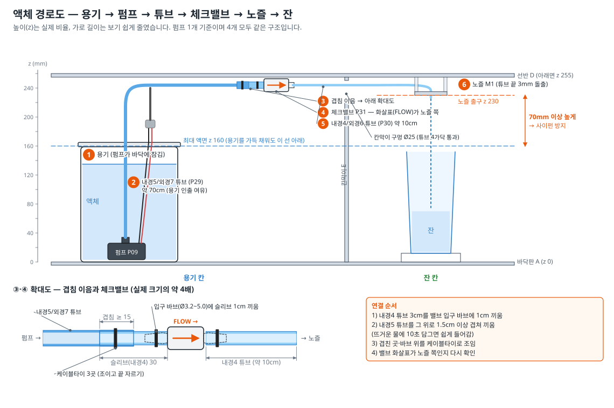

**액체 경로(SPEC §1)**: 용기(뚜껑에 Ø3 공기 구멍) → 펌프 출수구(외경 7.5 / 내경 4.9mm) → **내경5/외경7 실리콘 튜브** → (내경4 튜브 3cm 슬리브로 이음) → **체크밸브**(노즐 바로 앞, 화살표가 노즐 쪽) → 노즐. 노즐 출구는 모든 용기의 최대 액면보다 높게.

#### 튜브 재단표 (펌프 1개당, 4세트)

| 부분 | 튜브 | 길이 | 비고 |
|---|---|---|---|
| ② 펌프 → 체크밸브 | 내경5/외경7 (P29) | **70cm** | 실제 배치 후 남으면 STEP10에서 잘라 냄 |
| ③ 겹침 이음 슬리브 | 내경4/외경6 (P30) | **3cm** | 밸브 입구 바브에 1cm, 나머지 2cm에 내경5 튜브를 겹침 |
| ⑤ 체크밸브 → 노즐 | 내경4/외경6 (P30) | **15cm** (길게 자르고 STEP10에서 맞춤) | 최종 약 10~13cm |

*튜브는 가위나 니퍼 대신 **커터칼로 직각으로** 자릅니다. 비스듬히 잘리면 노즐에서 물줄기가 옆으로 휩니다.*

시음을 위해 식품용 부품(선택 P65 → P29 자리, P66 → P30 자리, P67 → P31 자리, [1.3](#food))으로 바꿀 때도 길이·잇는 방법은 이 표와 같습니다. 바꾼 뒤에는 이 STEP의 누수·역류 테스트(절차 7)와 STEP11 캘리브레이션을 다시 합니다(밸브 개방압·유로가 달라 유량이 바뀔 수 있음).

#### 절차

1. **번호 색 표시** — 튜브 양 끝에 색 수축튜브 링(약 1cm)을 끼워 펌프 번호를 표시합니다(예: 1 빨강, 2 노랑, 3 파랑, 4 초록). 색이 없으면 마스킹테이프에 번호.
2. **튜브를 뚜껑에 통과** — 내경5 튜브 끝을 뚜껑 **위에서 아래로** Ø7 구멍에 통과시킵니다.
3. **펌프 출수구에 끼우기** — 튜브 끝을 뜨거운 물에 10초 담갔다가 펌프 출수구(외경 7.5mm)에 **끝까지(약 8mm)** 밀어 넣습니다. *왜 뜨거운 물?* 실리콘이 부드러워져 쉽게 늘어나고, 식으면 다시 조여 새지 않습니다.
4. 펌프가 용기 바닥에 닿았을 때 튜브가 꺾이지 않는지, 뚜껑을 닫을 수 있는지 확인하고, 뚜껑 위 Ø7 구멍 둘레를 글루건으로 살짝 고정합니다(튜브가 미끄러져 펌프가 들리지 않게).
5. **겹침 이음 + 체크밸브(그림 12 확대도)**
   1. 내경4 튜브 3cm를 체크밸브 **입구 바브**(화살표 시작 쪽)에 1cm 끼웁니다.
   2. 내경5 튜브의 다른 끝을 뜨거운 물에 담근 뒤, 그 내경4 슬리브 위로 **1.5cm 이상** 겹쳐 끼웁니다.
   3. 케이블타이로 ① 겹친 부분(내경5 위) ② 바브 위(슬리브 위)를 조이고 꼬리를 자릅니다.
   4. 체크밸브 **출구 바브**에 내경4 튜브 15cm를 끼우고 케이블타이로 조입니다.
   *왜 이렇게 잇나?* 펌프 출수구는 내경5 튜브에, 체크밸브 바브(Ø3.2~5.0)는 내경4 튜브에 맞습니다. 내경4 튜브의 바깥지름(6mm)이 내경5 튜브 안(5mm)에 꽉 끼므로, 어댑터 없이 보유 튜브만으로 이을 수 있습니다.
6. **화살표 방향 재확인** — 체크밸브의 화살표(FLOW)가 **펌프에서 멀어지는 쪽(노즐 쪽)** 을 가리켜야 합니다. 거꾸로면 액체가 한 방울도 나오지 않습니다.
7. **누수 테스트(대야 위)**
   1. 용기 4개에 물을 반쯤 채우고 펌프 모듈 뚜껑을 닫습니다. 출구 튜브 끝을 각각 컵에 넣고, 체크밸브가 용기 뚜껑보다 높게(약 10cm 위) 오도록 들어 올려 잡습니다(실제 배치와 비슷하게).
   2. 펌프 선을 박스에 임시 연결합니다: 빨강 → 릴레이 K1~K4 NO, 검정 → TB2-2~5 (연결표 ㉑~㉘).
   3. 앱의 기기 탭 → **프라이밍**(길게 누르기)으로 각 펌프를 튜브가 물로 찰 때까지 돌립니다. 처음에는 공기가 빠지느라 몇 초 걸립니다.
   4. `{"cmd":"run","p":1,"ms":10000}` 또는 앱 프라이밍으로 10초씩 돌리며, 이음부마다 **마른 키친타월**을 감아 젖는지 봅니다.
   5. 펌프를 멈춘 뒤 출구 튜브 끝을 위로 들어 보세요. 밸브 아래쪽 튜브의 물이 **빠지지 않고** 남아 있으면 체크밸브가 제대로 닫히는 것입니다.
8. 새는 곳은 케이블타이를 한 번 더 감거나, 튜브를 1cm 잘라 새 단면으로 다시 끼웁니다.
9. (참고 측정) 체크밸브를 단 상태의 10초 유량을 재서 적습니다. 약 30~60ml(3~6 ml/초, 추정)이 예상값입니다. 3 ml/초보다 훨씬 적으면 [4장 문제 해결](#s4)을 보세요.

#### 확인 포인트

- [ ] ✔ 4세트 모두 체크밸브 화살표가 노즐 쪽
- [ ] ✔ 10초 구동 시 이음부 6곳(펌프 출수구·겹침·입구 바브·출구 바브 등) 모두 마름
- [ ] ✔ 멈춘 뒤 밸브 아래 튜브에 물이 남아 있음(역류·드립 방지 확인)
- [ ] ✔ 튜브 번호 색 표시
- [ ] ✔ 체크밸브 포함 10초 유량: 1 ____ / 2 ____ / 3 ____ / 4 ____ ml

#### 흔한 실수

- ⚠ 체크밸브 거꾸로 — 가장 흔한 실수입니다. 설치 직후 바로 확인.
- ⚠ 펌프를 물이 거의 없는 용기에서 돌림 → 공기를 빨아 유량이 0이 되고 펌프가 공회전합니다. 액면은 최소 약 30mm.
- ⚠ 튜브가 납작하게 꺾임 → 유량 감소. 구부릴 때는 크게(반지름 1cm 이상) 돌립니다.
- ⚠ 펌프 출수구에 내경4 튜브를 억지로 끼우기 → 너무 빡빡해 출수구가 부러질 수 있습니다. 출수구는 내경5.

### STEP 9. 외형 제작 (재단 · 구멍 · 조립 · 방수) {#step9}

> **목표**: 포맥스 5T로 본체를 만든다(W420 × D260 × H380). 구멍을 모두 뚫은 뒤 조립하고, 액체가 닿는 이음새를 방수 처리한다.
> **준비물**: 포맥스(P34) 또는 재단된 판 A~N, L자 꺾쇠(P36) 12, M3×10 볼트(P37)·너트(P38) 약 30쌍, 순간접착제(P42), 글루건+스틱(P43), 그로밋(P44) 3, 자석 캐치(P45) 2(상판 C도 자석으로 붙이면 P69 2~4개 더, 선택), 고무발(P41) 4, 버튼(P03), LED(P05)+R1(P06), 앞판 선: UL1007 노랑(P24) 40cm × 4 + 검정(P62) 40cm 1가닥과 짧은 선, 드릴·스텝드릴, 커터칼·쇠자·직각자, 연필, 사포
> **소요 시간**: 6~8시간 (재단 주문 시 3~4시간) + 접착제 굳는 시간

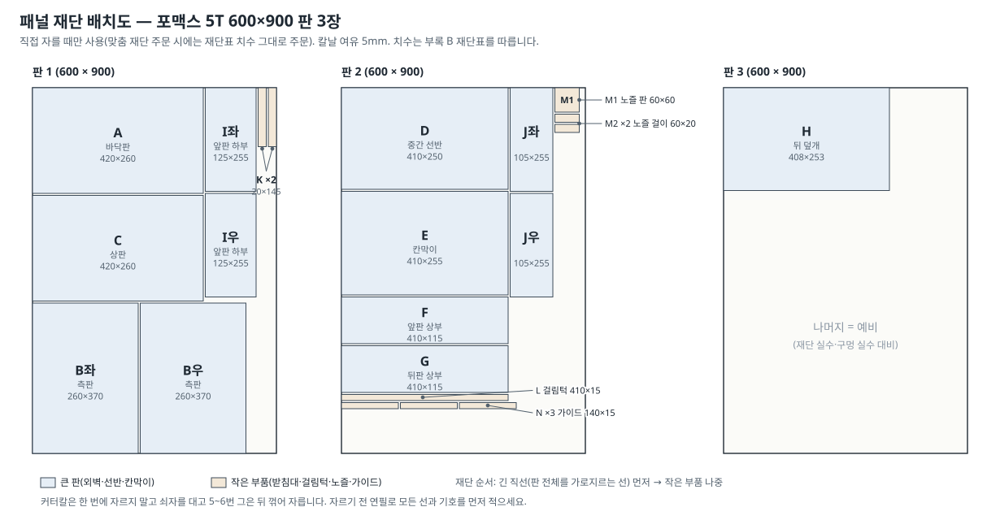

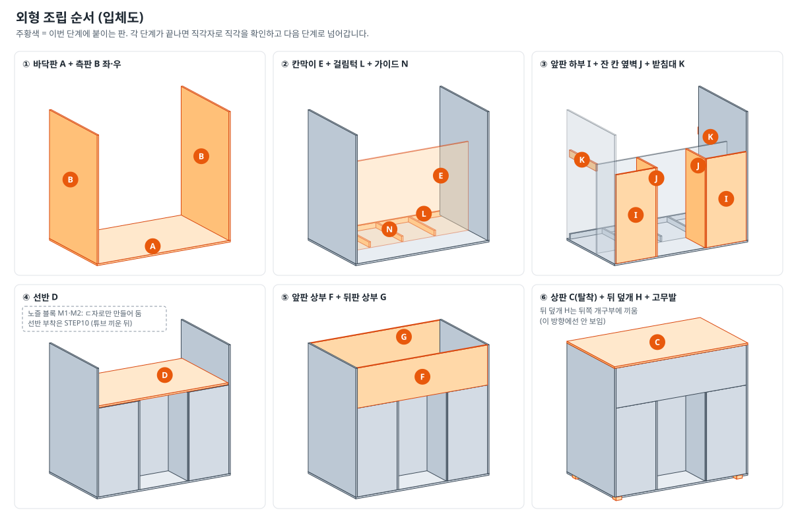

#### 절차 가. 판 준비

1. **재단 주문(권장)**: [부록 B 재단표](#appB)의 치수·수량을 그대로 재단 쇼핑몰에 주문합니다(오차 ±1~2mm).
   **직접 재단**: 그림 13대로 연필로 모든 선과 기호를 먼저 그린 뒤, 쇠자를 대고 커터칼로 5~6번 그어 꺾어 자릅니다. 긴 직선부터, 작은 부품은 나중에.
   *왜 여러 번?* 포맥스는 한 번에 세게 자르면 칼이 휘어 단면이 비뚤어집니다.
2. 모든 판의 **안쪽 면**에 연필로 기호(A, B좌, B우 …)와 "앞" 방향 화살표를 적습니다. 단면은 사포로 살짝 다듬습니다.
3. 재단된 판을 바닥에 놓고 직각자로 네 모서리가 직각인지 확인합니다.

#### 절차 나. 구멍 가공 (조립 전에 모두 뚫기)

판의 **왼쪽 아래 모서리를 기준(앞에서 볼 때)** 으로 잰 위치입니다. 구멍은 송곳으로 중심을 찍고 → Ø3 드릴로 안내 구멍 → 스텝드릴로 넓힙니다.

| □ | 판 | 구멍 | 위치 (판 기준) | 용도 |
|:-:|---|---|---|---|
| [ ] | D 선반 410×250 | Ø20 × 2 | 왼쪽 끝에서 55 / 오른쪽 끝에서 55, **뒤쪽 끝에서 35** | 펌프 선 통로 + 그로밋 |
| [ ] | D 선반 (선택) | Ø3.5 × 2 | 왼쪽 끝에서 110 / 290, 뒤쪽 끝에서 75 | 전장 박스를 **볼트로** 고정할 때만(M3×15 P68, STEP10 절차 1). 벨크로(P64)로 고정하면 뚫지 않음 |
| [ ] | E 칸막이 410×255 | Ø25 × 1 | 가로 가운데(205), **위쪽 끝에서 17** | 튜브 4가닥 통로 |
| [ ] | F 앞판 상부 410×115 | Ø16 / Ø5 | 오른쪽 끝에서 70 / 110, 높이 가운데(57.5) | 버튼 SW2 / LED1 |
| [ ] | G 뒤판 상부 410×115 | Ø12 / 사각 / Ø(실측) | **뒤에서 볼 때** 왼쪽 끝에서 40 / 90 / 140, 높이 가운데 | 어댑터 선(그로밋) / SW1 / F1 — **STEP4 절차 2에서 미리 뚫음** |
| [ ] | H 뒤 덮개 408×253 | Ø25 (선택) | 가로 가운데, 위쪽 끝에서 25 | 손가락 걸이 |
| [ ] | 노즐 판 M1 60×60 | Ø6.5 × 4 (한 줄) | 왼쪽 끝에서 12·24·36·48, 앞쪽 끝에서 30 | 튜브 끝 (그림 15) |
| [ ] | A 바닥판 · B 측판 | Ø3.5 | 꺾쇠 구멍에 맞춰 조립 때 | M3 볼트 |

- G판의 사각 구멍(로커 스위치)은 STEP4에서 잰 크기보다 **0.5mm 작게** 4모서리에 Ø3 구멍을 뚫고 커터칼로 잇고, 줄·사포로 넓혀 가며 스위치가 "딸깍" 끼워질 때까지 맞춥니다.
- G판은 뒤에서 볼 때와 앞에서 볼 때 좌우가 바뀝니다. **G판 바깥면에 "뒤(바깥)"라고 써 두고** 바깥면을 보며 위치를 잽니다.
- **그로밋(P44)** 은 선반 D의 **Ø20 구멍 2개용**과 뒤판 G의 **Ø12 구멍 1개용**, 모두 판 두께 5mm용입니다(BOM P44와 같음). 5mm 판에 맞는 그로밋을 못 구하면 사지 않고 **글루건으로 구멍 가장자리를 둥글게 마감**해도 됩니다(전선 피복 보호가 목적).
- 뒤판 G의 Ø12 그로밋은 어댑터 플러그(머리)가 그로밋 가운데 구멍보다 커서 통과하지 못할 수 있습니다(추정). 그래서 G에는 **지금 끼우지 않고**, STEP10에서 플러그를 맨 구멍으로 먼저 통과시킨 뒤 끼웁니다. 구멍을 뚫기 전에 플러그 머리 지름을 자로 재서, **12mm보다 크면** G 구멍을 그만큼 키웁니다(실측).

#### 절차 다. 조립 (그림 14 순서)

> 접착: 포맥스끼리는 **순간접착제(P42)** 로 맞대어 붙이고(10초 누름), 굳은 뒤 안쪽 모서리를 **글루건**으로 한 줄 더 보강합니다. 힘을 받는 곳은 **L자 꺾쇠 + M3×10 볼트·너트**로 고정합니다(포맥스에 목나사는 잘 빠짐).

4. **① 바닥판 A + 측판 B 좌·우** — B를 A 위 양끝(x 0~5, 415~420)에 세워 붙이고, 안쪽 모서리에 꺾쇠를 한쪽에 2개씩(y 약 25, 85 위치 — 용기가 놓이지 않는 앞쪽 빈 공간) 볼트로 고정합니다. 직각자로 A와 B가 90°인지 확인.
   *왜 앞쪽에?* 용기 칸(y 110~255) 바닥에 꺾쇠가 있으면 용기가 기울어집니다.
5. **② 칸막이 E + 걸림턱 L + 가이드 N** — E를 y 105~110 위치에 세워 A·B에 붙입니다(구멍이 위쪽, 가운데). L(410×15)은 A 위 뒤쪽 끝(y 250~255)에 **세워서** 붙입니다(뒤 덮개가 안으로 밀려 들어오지 않게). N 3개(선택)는 용기 사이(x 약 107, 210, 312)에 세워 붙여 용기가 미끄러지지 않게 합니다.
6. **③ 앞판 하부 I + 잔 칸 옆벽 J + 받침대 K** — I 좌·우를 앞면(y 0~5)에, J 좌·우를 x 130~135 / 285~290에 세워 E와 I에 붙입니다(잔 칸 폭 150). K 2개를 측판 안쪽 용기 칸 구간(y 110~255) 높이 z 235~255에 붙입니다(선반 받침).
7. **④ 선반 D** — 그로밋(P44) 2개를 D의 Ø20 구멍에 끼운 뒤, D를 I·J·E·K 위에 얹어 붙입니다(z 255~260). 선반 위쪽(전장부)에서 D와 B를 꺾쇠 2개씩(총 4개)으로 고정합니다. 꺾쇠는 **용기 칸 위 구간(y 약 150·220)** 에 달고, D 아래로 나온 볼트에는 뒤쪽 개구부(H 자리, 아직 열려 있음)로 손을 넣어 너트를 끼웁니다.
   *왜 뒤쪽에?* D의 앞쪽(y 105 이하) 아래는 이미 붙인 I·J·E·B·A로 막힌 빈 공간이라 손이 닿지 않습니다.
   **노즐 블록**: 노즐 판 M1(60×60) 위 양끝에 노즐 걸이 M2(60×20) 2개를 세워 붙여 "ㄷ"자 블록을 만들어 둡니다. 선반에는 **STEP10에서 튜브를 끼운 뒤** 붙입니다.
   *왜 나중에?* 선반에 먼저 붙이면 좁은 틈(20mm)에서 튜브를 구멍에 넣기가 매우 어렵습니다.
8. **⑤ 앞판 상부 F + 뒤판 상부 G** — F에 버튼(P03)을 끼워 뒤에서 너트로 조이고, LED를 Ø5 구멍에 앞에서 밀어 넣어 뒤에서 글루건으로 고정합니다. LED의 긴 다리(+)에 R1 220Ω을 납땜하고 수축튜브로 덮습니다. 부저(P04, 선택)는 F 안쪽 버튼 옆에 양면테이프 + 글루건으로 붙입니다.
   - **앞판 GND 공통선**: 검정 UL1007(P62) 40cm 한 가닥을 F 안쪽에 지나가게 하고, 버튼 단자 2(㉞)·LED 짧은 다리(㊱)·부저 GND(㉜)를 여기에 납땜합니다. 끝은 박스로 갑니다(㉛).
   - 신호선 **노랑 UL1007(P24)** 40cm 4가닥: 버튼 단자 1(㉝), R1의 다른 끝(㉟), 부저 I/O(㉚), 부저 VCC(㉙)를 납땜·연결해 둡니다. 4가닥이 모두 노랑이므로 **자르자마자 양 끝에 번호 테이프(㉙·㉚·㉝·㉟)** 를 붙이고, 납땜할 때 번호를 보며 잇습니다.
   그다음 F를 y 0~5, z 255~370에 붙입니다.
   - **G 붙이기**: G에는 STEP4에서 SW1·F1이 끼워져 납땜되어 있습니다. 먼저 **어댑터를 콘센트에서 뽑고**, ②를 J1 + 나사에서, ④를 TB1-8에서 빼 박스 뒤 벽 구멍 밖으로 빼냅니다(끝에 ②·④ 번호 테이프, 드러난 심선은 테이프로 감쌈). 그다음 G를 바깥면("뒤(바깥)")이 밖을 보게 y 255~260에 붙입니다. ②·④는 STEP10에서 다시 연결하고, G의 Ø12 그로밋도 STEP10에서 끼웁니다.
9. **⑥ 상판 C(탈착)** — **C는 접착하지 않습니다**(전장부 정비용).
   1. **너트 미리 붙이기(캡티브 너트)** — 꺾쇠 4개를 B에 달기 **전에**, 각 꺾쇠의 가로 다리(C가 얹힐 쪽) 구멍 **아래**에 M3 너트를 대고 위에서 M3×10 볼트를 돌려 너트를 붙잡습니다. 그 상태로 너트 바깥 테두리에 순간접착제(P42)를 조금 바릅니다(에폭시가 있으면 더 튼튼함). 볼트 나사산에 식용유나 바셀린을 살짝 묻혀 두면 접착제가 볼트에 붙지 않습니다. 굳으면(약 10분) 볼트만 빼 둡니다.
      *왜?* C를 얹으면 전장부(선반 위 칸)가 B·F·G·D·C로 사방이 막혀 손이 들어가지 않으므로, 꺾쇠 아래 너트를 손으로 잡을 수 없습니다. 너트를 붙여 두면 처음 조일 때도, 정비 때(STEP7 ⑧ 분리·USB 업로드) C를 풀 때도 위에서 볼트만 돌리면 되고, 빠진 금속 너트가 릴레이 나사 단자·레버 커넥터 위로 떨어져 단락될 일도 없습니다.
   2. 꺾쇠를 측판 B 안쪽 맨 위에 좌우 2개씩 볼트·너트로 답니다(가로 다리 윗면 = B 윗면 높이, 붙인 너트는 아래쪽). 이 볼트는 B 바깥에서 넣고, 안쪽 너트는 위가 열려 있는 지금 끼웁니다.
   3. C를 얹고 꺾쇠 구멍 위치를 C 위에 연필로 표시 → **C를 내려서 따로** Ø3.5로 뚫습니다(본체 위에서 드릴 금지).
   4. C를 얹고 위에서 M3×10 볼트 4개만 돌려 고정합니다.
   - 대안(선택): 뒤 덮개 H처럼 자석 캐치로 C를 붙여도 됩니다. 이때는 H용 P45 2개와 별도로 **P69(선택, 2~4개)** 를 삽니다(BOM 4.2절, 다이소).
10. **뒤 덮개 H** — 뒤쪽 개구부(410×255)에 끼워 보고(1mm 여유), 걸림턱 L과 H 안쪽에 자석 캐치(P45) 2개를 붙입니다.
11. **고무발** — 바닥판 A 아래 네 모서리(각 모서리에서 20mm 안쪽)에 고무발(P41) 4개를 붙입니다.

#### 절차 라. 방수 처리

12. 용기 칸과 잔 칸의 **바닥 이음새**(A와 B·E·I·J·L이 만나는 안쪽 모서리)를 글루건으로 빈틈없이 한 줄 메웁니다.
    *왜?* 흘린 액체가 판 사이 틈으로 스며들면 닦기 어렵고 냄새가 납니다. 바닥에 고여야 닦을 수 있습니다.
13. 잔 칸 바닥에는 드립 트레이(P33)를 놓습니다. 원하면 잔 칸 바닥에 투명 시트지를 붙입니다.
14. 선반 D 위쪽(전장부 쪽) 그로밋 둘레도 배선 후(STEP10) 글루건으로 막습니다.

#### 확인 포인트

- [ ] ✔ 외형 치수 W420 × D260 × H380(±2mm), 모서리 직각
- [ ] ✔ 구멍 표의 모든 구멍 가공 완료, 버튼·LED 장착
- [ ] ✔ 노즐 블록(M1+M2) 완성, 선반에는 아직 안 붙임
- [ ] ✔ 꺾쇠 아래 너트 4개가 접착되어 있고, 상판 C가 위에서 볼트 4개만으로 열고 닫힘
- [ ] ✔ G에 SW1·F1이 끼워진 채 붙음, ②·④ 끝에 번호 라벨
- [ ] ✔ 뒤 덮개 H가 자석으로 고정되고 쉽게 열림
- [ ] ✔ 바닥 이음새 방수 처리

#### 흔한 실수

- ⚠ G판을 앞에서 보고 구멍 위치를 잼 → 좌우가 바뀌어 전장 박스와 멀어집니다. 바깥면(뒤) 기준.
- ⚠ 순간접착제를 많이 바름 → 오히려 늦게 굳고 하얗게 번집니다. 얇게 바르고 10초 누름.
- ⚠ 조립 후 구멍 뚫기 → 드릴이 다른 판에 닿거나 판이 깨집니다. **조립 전에 모두 뚫기.**
- ⚠ 용기 폭을 확인하지 않고 재단 → 용기 4개가 안 들어갑니다. 2.4의 결정을 먼저.

### STEP 10. 최종 조립 · 배선 정리 {#step10}

> **목표**: 전장 박스·전원 부품·펌프 모듈·배관을 본체에 넣고 연결한다. 액체 쪽(아래)과 전기 쪽(위)이 확실히 나뉘도록 배선·배관을 정리한다.
> **준비물**: 완성된 본체(STEP9), 전장 박스(STEP5), 전원부(STEP4), 펌프 모듈+배관(STEP8), 노즐 블록, 드립 트레이(P33), 케이블타이·접착 마운트(P27·P28), 글루건, 접착식 벨크로 P64 4쌍(2.3), 멀티미터, (박스를 볼트로 고정할 때만) M3×15 볼트 2개(P68, 선택) + M3 너트 2개(P38)
> **소요 시간**: 3~4시간

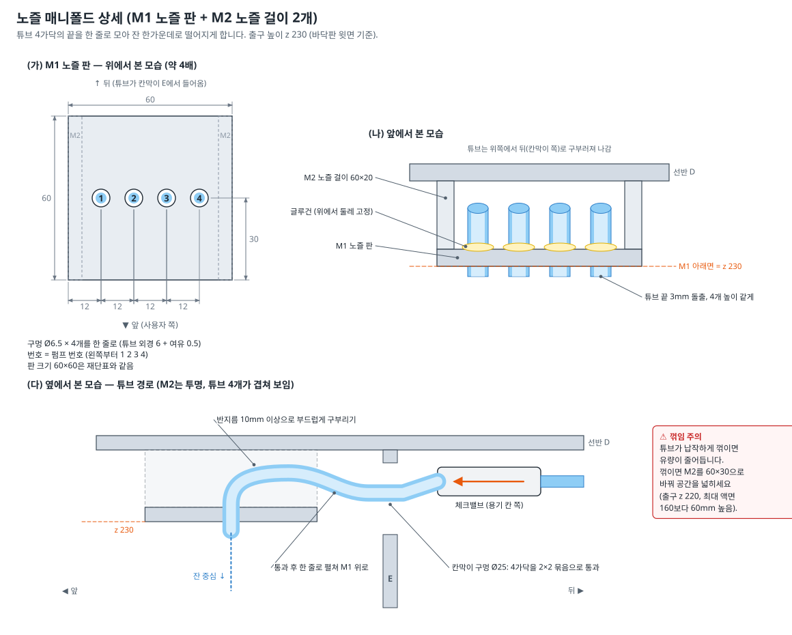

#### 절차

1. **전장 박스 올리기** — 상판 C를 떼고, 박스를 선반 D 위 x 105~305, y 40~190 위치(그림 4 (다))에 놓습니다. 박스 바닥 네 모서리와 D의 같은 자리에 **접착식 벨크로(찍찍이) P64** 를 한 쌍씩(10쌍 중 4쌍) 붙여 고정합니다. 붙일 면의 먼지·기름을 닦고 꾹 누르고, 55×35mm가 박스 모서리보다 크면 잘라 씁니다(폼 양면테이프로 한 번 더 잡아도 됨). 박스 바닥과 D에는 구멍을 뚫지 않습니다.
   *왜 볼트가 아닌가?* 박스 앞쪽 모서리 아래(x 5~130 / 290~415, y 5~105)는 I·J·E·B·A·D로 사방이 막힌 빈 공간(그림 4 (나))이라 너트를 끼울 손이 들어가지 않고, 조립이 끝난 본체에 구멍을 뚫으면 STEP9의 "조립 후 구멍 뚫기 금지"와도 어긋납니다. 벨크로는 정비 때 박스를 들어 올릴 수도 있습니다.
   - (선택) 볼트로 단단히 잡고 싶으면 **뒤쪽 두 모서리(x 약 115·295, y 약 180 — 아래가 용기 칸)** 만 씁니다. D 구멍은 STEP9 구멍 표의 "D 선반 (선택)" 행에서 조립 전에, 박스 바닥 구멍은 STEP5 박스 준비 때(속판을 달기 전) 뚫어 둡니다. 볼트는 **M3×15(P68, 선택 — 디바이스마트 주문에 함께)**, 너트는 **P38**을 씁니다. 너트는 뒤 덮개 H를 열고 용기를 꺼낸 뒤 용기 칸 쪽(D 아래)에서 끼워 조입니다. *왜 15mm?* 볼트가 박스 바닥 + D(5mm) + 너트를 지나 나와야 해서 M3×10(P37)은 짧을 수 있습니다(박스 바닥 두께 실측).
2. **전원선 ②·④ 다시 연결(필수)** — SW1·F1은 STEP4에서 이미 G에 끼워져 있고, G는 STEP9에서 본체에 붙었습니다.
   1. G 안쪽에 매달린 ②·④ 끝의 테이프를 벗기고 박스 **뒤 벽 Ø16 구멍**으로 넣습니다.
   2. **② → J1 + 나사, ④ → TB1-8**에 연결하고 살짝 당겨 봅니다(STEP9에서 뺀 선 — 빠뜨리면 SW1을 켜도 전원이 들어오지 않습니다).
3. **어댑터 선(①)** — 어댑터 플러그를 G의 **Ø12 구멍(그로밋 없이)** 으로 **바깥에서 안으로** 넣습니다. 그다음 Ø12용 그로밋 한쪽을 커터칼로 한 번 갈라(칼집) 케이블에 옆으로 끼우고, 구멍에 밀어 넣습니다. 플러그는 박스 뒤 벽 구멍을 지나 J1에 꽂습니다. G 안쪽에서 선을 케이블타이로 한 번 묶어(매듭처럼) 밖에서 잡아당겨도 J1이 빠지지 않게 합니다(장력 완화).
   - ①·②·④가 모두 연결되면 **STEP4 절차 11·12를 다시** 합니다: 어댑터를 뽑은 상태에서 TB1–TB2 단락 검사 → 어댑터를 꽂고 SW1 OFF **0V** / ON **4.9~5.25V** → SW1 OFF.
4. **앞판 배선** — 앞판 선(㉙~㊱)을 박스 앞 벽 구멍으로 넣어 연결합니다(번호 테이프와 색을 보고 하나씩):
   - ㉙ 부저 VCC(노랑, 테이프 ㉙) → **TB3-3** · ㉚ 부저 I/O(노랑, 테이프 ㉚) → **GPIO23 (J3-2)**
   - ㉛ 앞판 GND 공통선(검정) → **ESP32 GND (J3-7)**
   - ㉝ 버튼(노랑, 테이프 ㉝) → **GPIO4 (J3-13)** · ㉟ R1·LED(노랑, 테이프 ㉟) → **GPIO2 (J3-15)**
   - 노랑 4가닥은 색이 같으므로 **번호 테이프만 보고** 꽂습니다. 특히 ㉙(3V3)을 GPIO 단자에, ㉚·㉝·㉟를 TB3에 꽂지 않게 한 가닥씩 확인합니다.
5. **용기·펌프 모듈 넣기** — 뒤 덮개 H를 열고 용기 1~4를 왼쪽부터 순서대로 넣습니다.
   - 펌프 1·2 선 → 선반 왼쪽 그로밋(x 60), 펌프 3·4 선 → 오른쪽 그로밋(x 360) → 박스 옆 벽 구멍 → 연결표 ㉑~㉘:
     펌프 1 빨강 → **K1 NO**, 검정 → **TB2-2** · 펌프 2 → **K2 NO** / **TB2-3** · 펌프 3 → **K3 NO** / **TB2-4** · 펌프 4 → **K4 NO** / **TB2-5**.
   - 그로밋 아래에서 전선을 **U자로 한 번 늘어뜨린(드립 루프)** 뒤 올립니다. *왜?* 전선을 타고 흐르는 물방울이 U자 바닥에서 떨어져 구멍으로 들어가지 않습니다.
   - 용기를 뒤로 30cm 꺼낼 수 있을 만큼 전선·튜브 여유를 용기 칸 안에 남깁니다.
6. **체크밸브 고정** — 선반 D 아래(용기 칸 쪽), 칸막이 구멍 근처(y 120~160)에 접착 마운트(P28)를 붙이고 체크밸브 4개를 가로로 케이블타이 고정합니다. **화살표가 앞(칸막이·노즐 쪽)** 을 향합니다.
7. **노즐 연결(그림 15)**
   1. 각 체크밸브의 내경4 출구 튜브를 칸막이 E의 Ø25 구멍으로 잔 칸 쪽에 통과시킵니다(4가닥을 2×2로 묶어서).
   2. 노즐 블록(M1+M2)을 잔 칸 안에서 손에 들고, 튜브를 **왼쪽부터 펌프 1·2·3·4 순서**로 M1 구멍에 위에서 아래로 끼웁니다.
   3. 튜브 끝이 M1 아래로 **3mm** 나오게 맞춘 뒤, 커터칼로 4개 끝을 같은 높이로 직각으로 자릅니다.
   4. M1 위쪽에서 튜브 둘레를 글루건으로 고정합니다.
   5. 노즐 블록 M2 윗면에 순간접착제(또는 글루건)를 바르고 선반 D 아래 **x 180~240, y 22~82**(블록 중심 = 잔 칸 가운데 x 210, y 52)에 30초간 눌러 붙입니다. 튜브가 납작하게 꺾이지 않았는지 확인합니다.
   6. 줄자로 바닥판 윗면에서 M1 아랫면까지 **230mm** 인지 잽니다.
   *왜 한 줄로?* 2×2로 배치하면 뒤쪽 구멍으로 가는 튜브와 앞쪽 구멍으로 가는 튜브가 같은 줄에서 겹쳐, 좁은 틈(20mm)에서 심하게 꺾입니다. 한 줄이면 4가닥이 나란히 같은 모양으로 구부러집니다.
8. **튜브 길이 정리** — 내경5 튜브(펌프 → 체크밸브)가 너무 길어 용기 칸에서 꼬이면, 용기 인출 여유(약 30cm)를 남기고 잘라 다시 잇습니다.
9. **드립 트레이** — 잔 칸 바닥 가운데에 놓습니다. 노즐 바로 아래가 트레이 가운데가 되도록.
10. **배선 정리**
    - 박스 안: 가는 신호선 묶음과 굵은 전원선을 따로 케이블타이로 묶고, 박스 벽 구멍을 글루건으로 막습니다.
    - 선반 위: 그로밋 둘레를 글루건으로 막습니다.
    - 튜브는 **전장부(선반 위)로 절대 올라가지 않게** 합니다. 모든 튜브 이음부는 선반 아래에 있습니다.
11. **최종 연결 확인** — STEP6 점검표를 한 번 더 하고, 이번에는 펌프 선까지 포함해 TB1–TB2 단락이 없는지 봅니다.
12. 박스 뚜껑을 닫고 상판 C를 위에서 볼트 4개로 고정합니다(너트는 STEP9에서 꺾쇠에 붙여 둠).

#### 액체·전장부 격리 점검

- [ ] ✔ 튜브·이음부·체크밸브가 모두 선반 **아래**에 있음
- [ ] ✔ 전장 박스 벽 구멍 4곳, 선반 그로밋 2곳이 글루건으로 막힘
- [ ] ✔ 펌프 선에 드립 루프가 있음
- [ ] ✔ 박스 뚜껑이 닫힘, 상판 C 고정
- [ ] ✔ 액체를 흘려도 전장부까지 올라갈 길이 없음(선반이 막고 있음)

#### 확인 포인트

- [ ] ✔ 노즐 출구 높이 230mm, 튜브 끝 4개 높이 같음
- [ ] ✔ 펌프 번호 = 용기 번호 = 노즐 구멍 번호 = 앱 슬롯 번호
- [ ] ✔ 용기를 뒤로 꺼냈다 넣을 수 있음(선·튜브가 걸리지 않음)
- [ ] ✔ 어댑터 선을 밖에서 당겨도 J1이 빠지지 않음
- [ ] ✔ ② → J1 +, ④ → TB1-8 다시 연결, SW1 OFF 0V / ON 약 5V 재확인
- [ ] ✔ 전장 박스가 벨크로(또는 뒤쪽 볼트 2개)로 고정됨

#### 흔한 실수

- ⚠ 노즐 구멍 번호와 펌프 번호가 뒤섞임 → 기능에는 문제없지만 고장 찾기가 어렵습니다. 번호를 맞추세요.
- ⚠ 튜브를 팽팽하게 당겨 고정 → 용기를 꺼낼 수 없고 이음부가 빠집니다. 여유를 남기세요.
- ⚠ 노즐 블록을 비스듬히 붙임 → 물줄기가 잔 밖으로 떨어집니다. 붙이기 전에 잔을 놓고 위치를 확인.

### STEP 11. 캘리브레이션 (유량 맞추기) {#step11}

> **목표**: 펌프마다 "1초에 몇 ml가 나오는지(ml/초)"를 재서 기기에 저장해, 앱에서 정한 양이 정확하게 나오게 한다.
> **준비물**: 실제로 쓸 재료(또는 물), 계량컵 또는 주방 저울(1g 단위), 버릴 컵, 휴대폰 앱, 기록표([부록 C](#appC))
> **소요 시간**: 1~1.5시간 (펌프당 약 15분)

#### 왜 꼭 해야 하나요?

이 기기는 "양"을 직접 재지 않고 **"시간"으로 양을 정합니다**(ml ÷ 유량 = 구동 시간). 펌프마다, 튜브 길이·높이마다, 액체의 끈적임마다 1초에 나오는 양이 다릅니다. 펌웨어의 기본값 20 ml/초는 임시값이라, 실제 유량(약 3~6 ml/초, 추정)보다 크게 잡혀 있어 **캘리브레이션 전에는 요청한 양보다 훨씬 적게** 나옵니다(넘치지 않는 안전한 쪽). 그래서 캘리브레이션하지 않은 펌프가 있으면 앱의 바텐더·기기 탭에 **"캘리브레이션 전 — 실제보다 적게 나올 수 있어요"** 배너와 마법사 바로가기가 뜹니다(SPEC §5.6).

#### 절차 (앱 캘리브레이션 마법사)

1. 용기에 실제로 쓸 액체를 **절반쯤** 채웁니다.
   *왜 절반?* 액면 높이에 따라 유량이 15~20% 달라집니다(가득 찼을 때 많이, 거의 비었을 때 적게 — 추정). 절반에서 재면 평균에 가깝습니다.
2. 앱 **기기 탭 → 캘리브레이션 마법사 → 펌프 1 선택**.
3. 노즐 아래에 버릴 컵을 놓고 **"튜브 채우기(3초)"** 를 노즐에서 끊김 없이 나올 때까지 반복합니다(튜브 속 공기 빼기).
4. 빈 계량컵(또는 저울에 올린 컵, 0점 맞춤)을 노즐 아래에 놓고 **"10초 구동 시작"**.
5. 나온 양을 읽어 입력합니다. 저울을 쓰면 **ml = g ÷ 밀도** (아래 표). 앱이 `ml ÷ 10초`로 유량을 계산합니다.
6. **기기에 저장** → ESP32 플래시에 저장되어 전원을 꺼도 유지됩니다. 기기가 이 펌프를 "저장됨"(`calSet` = 1)으로 알려 주고, 4개 펌프를 모두 저장하면 "캘리브레이션 전" 배너가 사라집니다.
7. **검증**: 앱에서 펌프 1만 50ml인 레시피를 만들어(또는 시리얼 `{"cmd":"make","id":"chk","steps":[{"p":1,"ml":50}]}`) 실제로 47.5~52.5ml(±5%)가 나오는지 봅니다. 벗어나면 3~6을 2~3번 반복해 평균을 씁니다.
8. 펌프 2·3·4도 같은 방법으로 합니다.

시리얼 모니터로 할 때: `{"cmd":"run","p":1,"ms":10000}` → 측정 → `{"cmd":"setcal","p":1,"mlps":4.6}` (예: 46ml ÷ 10초) → `{"cmd":"getcal"}`로 확인(`"calSet":[1,0,0,0]`처럼 저장한 펌프가 1).

#### 액체별 차이 (참고, 추정값)

| 액체 | 밀도(g/ml, 대략) | 물 대비 유량 | 주의 |
|---|---|---|---|
| 물 | 1.00 | 기준 | |
| 맑은 주스(펄프 없음) | 1.04 | 거의 같음 | 펄프·과육은 체크밸브(Ø2mm)를 막음 → 걸러서 사용 |
| 탄산음료 | 1.01~1.04 | 약간 적음 | 펌프 속에서 거품이 생겨 양이 들쭉날쭉. **차갑게** 보관하면 덜함 |
| 시럽(원액) | 1.3 | 크게 적음(절반 이하 가능) | 물과 1:1로 희석해 쓰면 안정적. 사용 후 바로 세척 |
| 증류주 40% | 0.95 | 거의 같음 | 식품용 부품 교체 전·학교 시연에서는 사용하지 않음(1.3·1.4). 교체 뒤에도 성인 인증, 사용 후 바로 세척 |
| 색 물(물 + 식용색소) | 1.00 | 같음 | 시연용(마시지 않음). 사용 후 맑은 물로 세척 |
| 우유·유제품 | — | — | **사용하지 않음**(위생) |

#### 다시 해야 할 때

재료를 바꿨을 때, 튜브를 다시 잘랐을 때, 기기를 옮겨 용기·노즐 높이가 바뀌었을 때, **시연(발표) 당일 아침**.

#### 120초 제한 주의 (SPEC v2.1)

펌웨어는 레시피 제조(`make`)에서 펌프 1개가 **최대 120초**만 돌도록 막습니다(SPEC §2.3, v2.1에서 체크밸브의 느린 유량을 고려해 60→120초로 늘림). 재료 1개 최대 300ml, 한 잔 최대 500ml 제한도 함께 걸립니다.
- 유량이 2.5 ml/초 이상이면 300ml 제한이 먼저 걸리고, 그보다 느리면 120초 제한이 먼저 걸립니다(예: 2 ml/초 → 한 재료 최대 약 240ml).
- 직접 구동(`run`, 캘리브레이션·프라이밍용)은 한 번에 **최대 60초**, 세척(`clean`)은 펌프당 최대 30초입니다.
- 앱에서 `LIMIT` 오류가 나면 잔 용량을 줄이거나 재료 비율을 나누세요. 유량이 비정상적으로 느리면 [4장](#s4)의 원인부터 찾습니다.

#### 확인 포인트

- [ ] ✔ 펌프 4개 모두 유량 저장, `getcal` 값이 기록표와 같음
- [ ] ✔ 50ml 검증 오차 ±5% 이내
- [ ] ✔ 기록표에 날짜·재료·액면 상태 기록

#### 흔한 실수

- ⚠ 튜브를 채우지 않고(프라이밍 없이) 측정 → 처음 몇 초는 공기만 나와 유량이 작게 잡힙니다.
- ⚠ 용기가 가득 찬 상태에서만 측정 → 비어 갈수록 덜 나옵니다. 절반에서.
- ⚠ 저울 값을 그대로 ml로 입력(시럽 등) → 밀도로 나눠야 합니다.

### STEP 12. 시운전 · 세척 · 보관 {#step12}

> **목표**: 실제 사용처럼 여러 잔을 만들어 보며 문제를 찾고, 세척·보관 방법을 익힌다.
> **준비물**: 물(또는 시연용 색 물), 잔 여러 개, 앱, 미지근한 물, 식초 또는 베이킹소다, 키친타월
> **소요 시간**: 2시간

#### 절차 가. 시운전 (물로)

1. 앱 재료 탭을 실제 재료 이름으로 바꾸되, 내용물은 물로 시험합니다(예: 펌프 1 "사이다(물)").
2. **바텐더 탭** → 기분·맛 입력 → AI 레시피 → **기기로 제조 시작** → 진행 화면에서 펌프별 진행률 확인 → 완료 알림·진동·부저 "삐-삐".
   앱에서 평가(좋아요/별로예요 — 마시지 않고 버튼만 누름) 후 **"한 잔 더 만들까요?"** 에서 [예] → 같은 입력으로 다시 추천, [아니요, 다른 걸 원해요] → 탐색 모드(새 재료 제안)를 한 번씩 눌러 봅니다. 레시피 화면의 "다른 추천"을 두 번 연속 누르면 "새 재료를 장착해 볼까요?" 안내가 나오는지도 봅니다.
3. **비상정지 2가지**: 제조 중 ① 앱의 큰 **비상 정지** 버튼, ② 기기 앞의 **시작/정지 버튼** → 모두 즉시 멈추고 부저 "삐----".
4. **연결 끊김 시험**: 제조 중 휴대폰 블루투스를 끄면, 기기는 정해진 양만큼 끝까지 만들고 멈춰야 합니다(SPEC §2.4). 다시 켜면 앱이 자동 재연결합니다.
5. **연속 시험**: 200ml를 10잔 연속으로 만들며 ESP32 재부팅(LED가 다시 천천히 깜빡임), 누수, 발열, 소음을 봅니다. 한 재료를 많이(예: 150ml 이상) 넣어 펌프가 오래 도는 레시피도 만들어 보고, 끝난 뒤 펌프 쪽 용기가 미지근한 정도인지 확인합니다(펌프 1개 최대 120초).
6. **동시 모드**(선택): 앱 기기 탭 배출 모드를 "동시"로 바꿔 2잔 만들어 보고, 재부팅이 생기면 "순차"로 되돌립니다.

#### 절차 나. 세척 (매번 사용 후)

7. 용기의 재료를 비우고 **미지근한 물(40℃ 이하)** 을 채웁니다.
8. 앱 기기 탭 → **세척**(펌프당 10초) 2번 → 잔 칸에 큰 그릇을 놓고 받습니다. (시리얼: `{"cmd":"clean","ms":10000}`)
9. 맑은 물로 한 번 더 세척합니다.
10. 튜브 물 빼기: 펌프 모듈(뚜껑)을 용기에서 들어 올려 펌프가 물 밖에 있게 하고, 각 펌프를 **1~2초만** 돌려 튜브 속 물을 뺍니다. *길게 공회전시키지 않습니다.*
11. 용기·뚜껑·드립 트레이를 씻어 말립니다. 잔 칸 바닥을 닦습니다.

#### 절차 다. 정기 세척 (설탕 음료를 쓴 날, 일주일에 한 번)

12. 미지근한 물 1L에 식초 2~3큰술(또는 베이킹소다 1큰술)을 녹여 용기에 넣고 세척 10초 × 3번 → 10분 그대로 둠 → 맑은 물로 세척 2번.
13. 체크밸브가 끈적이면(잘 안 열림) 따뜻한 물로 여러 번 세척합니다. 그래도 안 되면 예비 체크밸브로 교체합니다.

#### 절차 라. 보관

14. 용기는 비워서 말리고 뚜껑을 살짝 열어 둡니다(곰팡이 방지).
15. 어댑터를 콘센트에서 뽑고, 먼지가 들어가지 않게 천을 덮습니다.
16. 오래 보관한 뒤 처음 쓸 때는 절차 나(세척)부터 합니다.

#### 확인 포인트

- [ ] ✔ 앱 전체 흐름(추천 → 제조 → 완료 → 피드백) 성공
- [ ] ✔ 비상정지 2가지 모두 동작
- [ ] ✔ 연결 끊김 시에도 정량 후 정지
- [ ] ✔ 10잔 연속 동안 재부팅·누수·과열 없음
- [ ] ✔ 세척·물 빼기 완료

#### 흔한 실수

- ⚠ 사용 후 재료를 넣은 채 퇴근 → 다음 날 체크밸브 고착·냄새.
- ⚠ 뜨거운 물(60℃ 이상)로 세척 → 펌프·용기 플라스틱 변형 위험.
- ⚠ 세척수를 받을 그릇 없이 세척 → 잔 칸이 넘칩니다.

<!-- pagebreak -->

## 4. 문제 해결 표 {#s4}

| 증상 | 가능한 원인 | 조치 |
|---|---|---|
| 앱에서 기기가 검색되지 않음 | 전원 꺼짐 / ⑧ 빠짐 / 다른 폰이 연결 중 / 권한 거부 / 웹앱을 지원하지 않는 브라우저 | SW1·어댑터 확인, ⑧ 재연결, 다른 폰 연결 해제, 앱 권한(근처 기기·위치) 허용, EN 버튼으로 재시작, 휴대폰 블루투스 껐다 켜기. 웹앱은 **Chrome·Edge + https 주소**에서만 블루투스가 됨(아이폰 불가) — 안 되면 APK 사용 |
| 연결은 되는데 "기기 정보(info)를 받지 못했어요" | 구버전(Wi-Fi) 펌웨어 | STEP7 절차 가로 v2 펌웨어 업로드 |
| 레시피 화면에 늘 "오프라인 추천"이 표시됨 | AI 키 미등록 / AI 추천 방식이 "오프라인" / 키 오류·사용량 한도·크레딧 소진 / 인터넷 끊김·응답 지연(25초) | 레시피 화면 위 안내에서 이유 확인 → 앱 설정 → **Gemini API 키** 의 **[키 확인]**(성공 / 키가 올바르지 않음 / 권한 없음 / 사용량 한도·크레딧 소진 / 인터넷 연결 없음 — [5장](#s5) 전날 점검, `../../app/README.md` 5장). 시연은 오프라인 추천으로도 진행 가능 |
| 펌프가 켜질 때 ESP32가 재부팅(LED가 다시 천천히 깜빡) | 전압 강하(브라운아웃) / **펌프 다이오드 방향 반대**(켜는 순간 단락) | C1 극성·연결 확인, 다이오드 띠 방향 확인(띠 = 빨강), 전원선을 AWG20으로 짧게, 순차 모드 사용, 필요하면 C2(100µF) 추가. 시리얼에 `리셋 원인: 브라운아웃`이 보이면 확정 |
| 릴레이가 딸깍하지 않음 | JD-VCC(5V) 미연결 / GND 미연결 / 핀 번호 틀림 / A안 입력 전류 부족 / B안인데 ⑨를 VCC 핀으로 옮기지 않음(캡만 끼움) | ⑨(A안: JD-VCC 핀 / B안: 입력 헤더 VCC 핀)·⑯(릴레이 GND)·⑪(VCC) 확인, `run` 명령으로 채널별 확인, A안이 약하면 B안(STEP2 절차 라) |
| 릴레이가 꺼지지 않음(계속 켜짐) | B안인데 ⑪(3V3)이 연결됨 / A안인데 점퍼가 꽂힘 / IN 선 빠짐 | 점퍼·VCC 연결을 STEP2 결정대로, `{"cmd":"stop"}`으로도 안 꺼지면 배선 문제 |
| 전원을 켜자마자 펌프가 돈다 | 펌프가 NC 단자에 연결 | 펌프 빨강을 **NO**로 옮김 |
| 펌프를 켜면 ESP32가 재부팅되거나 어댑터가 꺼짐(또는 퓨즈가 끊어짐) | 다이오드 방향 반대 / 펌프 선 단락 | 해당 펌프의 다이오드 띠가 빨강 쪽인지 확인, 이음부 피복 확인. **퓨즈가 멀쩡해도 다이오드가 맞다는 뜻이 아님**(4A 어댑터는 퓨즈보다 먼저 스스로 끊음). 수축튜브가 변색됐거나 냄새가 나는 다이오드는 교체. 퓨즈가 끊어졌으면 원인을 고친 뒤 3A로 교체 |
| 릴레이는 딸깍하는데 펌프가 안 돔 | COM에 5V 없음 / NO 선 빠짐 / 펌프 이음 불량 | TB1→COM(⑰~⑳) 확인, COM–GND 5V 측정, 펌프 선 도통 확인 |
| 펌프는 도는데 액체가 안 나옴 | 체크밸브 거꾸로 / 튜브 공기 / 액면 너무 낮음 / 튜브 꺾임 | 화살표 방향 확인, 프라이밍, 액체 보충(최소 30mm), 꺾인 곳 펴기 |
| 양이 레시피보다 훨씬 적음 | 캘리브레이션 안 함(기본 20 ml/초 — 앱에 "캘리브레이션 전" 배너) / 액면 낮음 / 공기 구멍 막힘 | STEP11 캘리브레이션, 용기 보충, 뚜껑 Ø3 공기 구멍 확인 |
| "캘리브레이션 전" 배너가 계속 보임 | 저장 안 된 펌프가 있음(`calSet` 0) | `{"cmd":"getcal"}`로 0인 펌프 확인 → STEP11로 저장 |
| 양이 들쭉날쭉 | 탄산 거품 / 액면 변화 / 튜브 속 공기 | 탄산은 차갑게, 절반 액면에서 재캘리브레이션, 제조 전 프라이밍 |
| 유량이 3 ml/초보다 훨씬 작음 | 체크밸브 유로(Ø2mm) 저항 / 꺾임 / 펄프 막힘 | 꺾임·막힘 해결, 그래도 느리면 체크밸브 제거 시험(노즐 높이 조건은 유지), 동시 모드 사용 |
| `LIMIT` 오류 | 한 재료 300ml 초과 / 총 500ml 초과 / 한 펌프 120초 초과(유량이 매우 느릴 때) / `run` 60초 초과 | 잔 용량 줄이기, 비율 조정, 유량이 너무 낮으면 원인 해결 |
| `BUSY` 오류 | 이미 제조 중 | 끝날 때까지 기다리거나 비상정지 후 다시 |
| 제조가 끝난 뒤에도 노즐에서 계속 똑똑 떨어짐 | 체크밸브 불량·당분 고착 / 노즐이 액면보다 낮음 | 세척 또는 교체, 노즐 높이 230mm·액면 ≤ 160mm 확인 |
| 펌프가 멈췄는데 액체가 계속 흐름 | 사이펀(노즐이 액면보다 낮음) | 노즐을 높이거나 용기를 덜 채움. 체크밸브 방향 확인 |
| 이음부에서 샘 | 케이블타이 느슨 / 겹침 부족 / 단면 비뚤어짐 | 케이블타이 추가, 1.5cm 이상 겹침, 튜브 끝을 직각으로 다시 자르기 |
| 앱 "펌프 1"인데 다른 펌프가 돎 | GPIO 핀 배선 뒤바뀜 / 노즐·용기 번호 혼동 | 연결표 ⑫~⑮ 재확인(26·27·32·33), 번호 라벨 정리 |
| 부저가 계속 울림 | ONE005가 아닌, LOW에 울리는 부저 모듈을 씀(ONE005는 HIGH = 울림) / I/O·VCC 핀을 바꿔 꽂음 | 모듈 인쇄대로 다시 꽂기, 다른 모듈이면 `config.h` `BUZZER_ON_LEVEL 0` 후 재업로드 |
| 업로드 실패 `Failed to connect` | BOOT 버튼 / 케이블 / 포트 점유 | `Connecting...` 때 BOOT 누르기, 데이터 케이블, 시리얼 모니터 닫기, Upload Speed 115200 |
| 시리얼 모니터 글자가 깨짐 | 속도 다름 | 115200 |
| 버튼을 눌러도 반응 없음 | ㉝·㉞·㉛ 연결 / 버튼 단자 잘못 선택 | 도통 모드로 버튼 누를 때만 "삐" 나는 단자 2개를 찾아 연결 |
| 상태 LED가 안 켜짐 | LED 방향 / R1 빠짐 / ㉟·㊱·㉛ / 외부 LED를 안 담 | LED 돌려 꽂기, 연결 확인. 보드에는 GPIO2 LED가 없어 외부 LED가 필수 |
| 용기를 꺼낼 때 튜브가 빠짐 | 여유 부족 | 용기 칸 안에 튜브·전선 30cm 여유 확보 |

<!-- pagebreak -->

## 5. 시연(발표) 체크리스트 {#s5}

기말 시연(발표)과 졸업작품 전시에 씁니다. 날짜는 학과 공지로 **확인 필요**합니다.

> ⚠ 식품용 부품으로 바꾸기 전까지는 기기에서 나온 액체를 **아무도 마시지 않습니다**([1.3](#food)). 시연은 색 물을 컵에 따르고 **양·색을 보여 주는 것**까지입니다. 졸업작품 전시에서 시음까지 하려면 그 전에 식품용 튜브·체크밸브 **P65·P66·P67**(BOM 4.2절, 가격 확인 필요)로 교체하고 STEP8·STEP11을 다시 합니다(1.3의 조건 — 팀원만).

### 전날

- [ ] 리허설: 발표 순서대로 한 번(추천 → 제조 → 완료 알림 → 양·색 확인 → 앱 평가 버튼 → "한 잔 더?"/탐색 모드) + 연속 10~20잔(물/색 물) — 문제 기록·수정
- [ ] 휴대폰 2대에 앱 설치(Releases 의 최신 APK, 한 대는 예비), 충전 100%, 보조배터리. 두 폰 모두 근처 기기·위치·알림 권한 허용. 예비로 PC(Chrome 웹앱 또는 EXE)도 준비
- [ ] 앱 AI 키 점검: 시연 폰의 **앱 설정**(오른쪽 위 ⚙, 기기 탭 맨 아래 "앱 설정"으로도 감) → **Gemini API 키** 칸이 "저장됨 ••••••••(마지막 4자리)"인지 확인하고 **[키 확인]** 을 누릅니다. 결과는 칸 아래 색 띠로 나옵니다(`../../app/README.md` 5장).
  - 초록 **"성공 — 이 키로 AI 추천을 쓸 수 있어요"** → 정상. **AI 추천 방식**이 **[Gemini(내 키)]** 인지도 봅니다.
  - 노랑 **"키는 정상이에요 — 모델을 바꿔 주세요"** → 같은 화면의 **모델** 목록에서 다른 모델을 고릅니다.
  - 빨강 **"키가 올바르지 않아요" / "권한 없음"** → 키를 다시 붙여 넣거나 Google AI Studio 에서 새 키를 발급받아 [키 확인] → [저장].
  - 노랑 **"사용량 한도·크레딧 소진"** → 무료 등급 한도. 잠시 뒤 다시 확인하고, 시연 직전에는 연습 호출을 줄입니다.
  - 빨강 **"인터넷 연결 없음"** → 휴대폰 인터넷(와이파이·데이터)을 확인하고 다시 누릅니다.
  - 노랑·빨강이 계속되면 같은 화면 맨 위 **"AI 추천 방식"** 을 **[오프라인]** 으로 바꿔 바텐더 탭에서 추천이 나오는지 확인해 둡니다(시연 장소 인터넷이 불안정할 때 이 방식으로 진행). 확인 후 다시 **[Gemini(내 키)]** 로 돌려 둡니다.
  - 키는 그 폰에만 저장됩니다. 공용·전시용 폰이면 시연이 끝난 뒤 키를 **삭제**합니다.
- [ ] 기기가 고장 났을 때를 대비해 앱 **데모 모드(가상 기기)** 로 화면 시연이 되는지 확인
- [ ] 노트북에 Arduino IDE + 펌웨어 폴더 + USB 케이블(펌웨어 다시 올릴 때)
- [ ] 예비 부품 상자: 퓨즈 3A ×2, 펌프(P09 예비) ×2, 체크밸브 ×1, 1N4007 ×2, 튜브 내경4·5 각 1m, 케이블타이, 점퍼선, 레버 커넥터 ×1, 수축튜브, 멀티미터, 일자·십자 드라이버, 글루건
- [ ] 시연용 액체 4가지 준비: **물에 식용색소를 탄 색 물**(예: 빨강·노랑·파랑·초록 — 섞이면 색이 바뀌어 비율이 눈에 보임) + 예비 1병씩. 앱 재료 이름은 실제 재료 이름(예: "사이다")으로 둬도 되지만 내용물은 색 물. 맑은 음료를 쓰더라도 **펄프 없는(걸러낸) 것만**(펄프는 체크밸브 Ø2mm를 막음), 마시지 않음
- [ ] 투명 **시연용 컵**(높이 200mm 이하) 10개 정도 — 마시지 않는 시연 전용(관람객에게 나눠 주지 않음), 시연 후 액체를 버릴 통
- [ ] 키친타월, 물티슈, 쓰레기봉투, 세척용 물통, 큰 그릇(세척수 받기)
- [ ] 멀티탭(콘센트까지 거리 확인), 테이블보
- [ ] 안내문: "시연용 색 물입니다 — 마시지 마세요", "버튼을 누르면 즉시 멈춥니다", 사용 방법 QR(웹앱 [https://paperji.github.io/smart-bartender/](https://paperji.github.io/smart-bartender/) — 데모 모드로 바로 체험), 팀 소개

### 당일 (설치)

- [ ] 기기를 평평한 테이블에 놓기(기울면 노즐이 잔 가운데를 벗어남), 콘센트 연결
- [ ] STEP6 점검표 빠르게 한 번 + 전압 확인(TB1–TB2 약 5V)
- [ ] 용기 세척 → 재료 채우기(최대 액면 이하, 용기 번호 = 앱 슬롯, 뚜껑 Ø3 공기 구멍이 막히지 않았는지)
- [ ] 앱 재료 탭 이름·잔량 입력, 성인 인증은 사용 안 함(주류 없음)
- [ ] **프라이밍 → 캘리브레이션**(STEP11) — 시연 장소 온도·재료 기준으로 다시. "캘리브레이션 전" 배너가 없는지 확인
- [ ] 시범 3잔: 추천 → 제조 → 양·색 확인(마시지 않음)
- [ ] 비상정지(앱·버튼) 한 번씩 확인

### 시연 중

- [ ] 잔량을 자주 확인(앱 잔량 경고), 액면이 30mm 밑으로 내려가기 전에 보충
- [ ] 드립 트레이 비우기, 잔 칸 닦기
- [ ] 한 사람은 앱 조작·발표, 한 사람은 재료·컵·청소 담당
- [ ] 블루투스가 끊기면: 앱이 자동 재연결 → 안 되면 앱의 기기 탭에서 다시 연결 → 그래도 안 되면 SW1 OFF/ON
- [ ] 이상(누수, 냄새, 재부팅 반복) → 즉시 SW1 OFF, 어댑터 뽑기 → 4장 문제 해결 표. 발표는 데모 모드로 이어 감

### 끝난 뒤

- [ ] 재료 비우기 → STEP12 절차 나(미지근한 물 2번) → 물 빼기
- [ ] 용기·트레이 세척·건조, 어댑터 뽑기
- [ ] 문제·개선점 기록(졸업논문·결과보고서 자료): 만든 잔 수, 오류 횟수, 평균 제조 시간, 50ml 검증 오차, 관람객 반응(앱·추천 화면에 대한 의견)

<!-- pagebreak -->

## 6. 개선 아이디어 (졸업논문 · 특허 · 후속 개선) {#s6}

| 아이디어 | 부품 (BOM) | 효과 | 주의 |
|---|---|---|---|
| **연동(페리스탈틱) 펌프로 교체** | P55 DFRobot DFR0523 ×4 (약 4.5만원/개) | 액체가 튜브에만 닿아 위생적, 회전 수 = 양이라 정확, 높이·점도 영향 적음, 체크밸브 불필요 | 4개 동시 구동 시 큰 전류 → 5V 10A급 전원 필요(확인 필요) |
| **로드셀(무게) 자동 보정** | P56 HX711 + P57 1kg 로드셀 | 잔 받침 아래 무게를 재 실제 나온 양으로 펌프를 멈춤 → 시간 제어 오차 보완, 논문 실험 데이터(정확도 그래프) 확보 | 잔 칸 바닥 구조 변경, 펌웨어에 "무게 목표" 모드 추가 |
| **MOSFET + PWM 속도 제어** | P58 4채널 MOSFET 보드 | 펌프 속도를 조절해 마지막 몇 ml를 천천히 → 정밀도 향상, 릴레이 소음 제거 | ESP32 3.3V로 켜지는지 확인, 플라이백은 쇼트키(1N5819) |
| **식품 등급 부품** | P65·P66 식품용(FDA/LFGB) 실리콘 튜브 · P67 식품용 체크밸브 (BOM 4.2절, 가격 확인 필요) | 위생 기준 충족 → 시음(1.3 조건)·주스 실사용 근거 | 지금과 같은 규격(내경5/외경7·내경4/외경6, 바브 Ø3.2~5.0)으로 고르기. 바꾼 뒤 STEP8·STEP11 다시. 졸업작품 전시에서 시음하려면 그 전에 교체 |
| **잔량 센서** | 초음파·정전용량 레벨 센서 | 앱의 잔량 추정 대신 실제 측정, 빈 용기 공회전 방지 | 용기마다 1개, 방수 |
| **잔 감지** | 적외선 근접 센서 | 잔이 없으면 제조 시작 안 함(쏟음 방지) | GPIO 추가(남는 핀: 25·13·18·19 중 확장 펌프와 겹치지 않게) |
| **펌프 8개 확장** | P08 예비 릴레이 + 펌프 4 | 재료 8가지 → AI 레시피 다양성 증가 | GPIO 25·13·18·19, `PUMP_COUNT 8`, 전원·공간 재검토 |
| **잔량 기반 유량 보정** | 펌웨어·앱 | 액면이 낮을수록 덜 나오는 현상(15~20%) 보정 | 캘리브레이션 데이터 2점(가득/반) 필요 |
| **외관 개선** | 아크릴(투명 앞판), 3D 프린팅 노즐, LED 조명 | 졸업작품 전시 완성도, 노즐 정렬 정확 | 레이저 커팅·프린터 이용 가능 여부 |
| **자동 세척 모드** | 물 전용 5번째 펌프 | 사용 후 버튼 한 번으로 세척 | 펌프·용기 추가 |

---

## 부록 A. 핀맵 요약 (SPEC §1) {#appA}

| 기능 | ESP32 핀 | 연결 | 비고 |
|---|---|---|---|
| 펌프 1 | GPIO 26 | 릴레이 IN1 | LOW = 켜짐 |
| 펌프 2 | GPIO 27 | 릴레이 IN2 | |
| 펌프 3 | GPIO 32 | 릴레이 IN3 | |
| 펌프 4 | GPIO 33 | 릴레이 IN4 | |
| (확장) 펌프 5~8 | GPIO 25, 13, 18, 19 | 2번째 릴레이 IN1~4 | `PUMP_COUNT` |
| 시작/정지 버튼 | GPIO 4 | 버튼 → GND | 제조 중 누르면 비상정지 |
| 상태 LED (필수) | GPIO 2 | 220Ω → 외부 LED → GND | 대기 천천히 깜빡 / 연결 켜짐 / 제조 중 빠르게 깜빡 |
| 부저 | GPIO 23 | 부저 I/O (VCC 3V3) | HIGH = 울림. 완료 삐-삐, 정지 삐---- |
| 릴레이 입력 전원 | 3V3 (TB3) | 릴레이 VCC | A안(점퍼 제거). B안(USB·어댑터 분리 후): ⑪ 먼저 제거 → ⑨(+5V)를 VCC 핀으로 옮김 → 점퍼 끼움(JD-VCC 핀엔 캡만) · VCC 5V (3V3 연결 금지) |
| 릴레이 코일 전원 | 5V (TB1) | 릴레이 JD-VCC | B안: VCC 핀 → 점퍼 캡 → JD-VCC |
| ESP32 전원 | 5V (TB1) | ESP32 5V 핀 | USB 사용 시 ⑧ 분리 |
| GND | 공통 | 별형 접지: J1 −에서 ⑤ → TB2(펌프), ⑦ → ESP32 GND(ESP32·릴레이) | 3V3 분배는 TB3 |

ESP32 DevKitC V4 핀 순서(안테나 위, USB 아래):
왼쪽 줄 위→아래 `3V3 EN VP VN 34 35 32 33 25 26 27 14 12 GND 13 D2 D3 CMD 5V`,
오른쪽 줄 위→아래 `GND 23 22 TX RX 21 GND 19 18 5 17 16 4 0 2 15 D1 D0 CLK`.
GPIO 6~11(CLK·D0~D3·CMD)은 플래시용이라 쓰지 않습니다.

## 부록 B. 재단표 (parts_research.md 5.2와 동일, W420 기준) {#appB}

| 기호 | 이름 | 가로 × 세로 (mm) | 수량 | 위치 · 가공 |
|---|---|---|---:|---|
| A | 바닥판 | 420 × 260 | 1 | 맨 아래, 고무발 4개 |
| B | 측판 (좌·우) | 260 × 370 | 2 | 바닥판 위 양끝 |
| C | 상판 (탈착) | 420 × 260 | 1 | 꺾쇠 4개 + M3 볼트. 꺾쇠 아래 M3 너트는 순간접착제로 미리 붙여 둠(**캡티브 너트**, STEP9 절차 다 9). 대안: 자석 캐치 P69(선택) |
| D | 중간 선반 | 410 × 250 | 1 | z 255~260, Ø20 × 2 (뒤쪽 끝에서 35, 좌·우 끝에서 55). **(선택) Ø3.5 × 2**(왼쪽 끝에서 110 / 290, 뒤쪽 끝에서 75 — 전장 박스를 볼트 P68로 고정할 때만, 조립 전에 뚫음. 벨크로 P64면 뚫지 않음) |
| E | 칸막이 | 410 × 255 | 1 | y 105~110, Ø25 (가운데, 위에서 17) |
| F | 앞판 상부 | 410 × 115 | 1 | Ø16 (오른쪽 끝에서 70), Ø5 (110), 높이 가운데 |
| G | 뒤판 상부 | 410 × 115 | 1 | 뒤에서 볼 때 왼쪽에서 Ø12(40, 그로밋) · 스위치 사각(90) · 퓨즈(140). **구멍은 STEP4(1주차)에서 뚫음**(SW1·F1을 먼저 끼운 뒤 납땜) → G는 가장 먼저 받거나 잘라 둠 |
| H | 뒤 덮개 (탈착) | 408 × 253 | 1 | 자석 캐치 P45 2, 손가락 구멍 Ø25(선택) |
| I | 앞판 하부 (좌·우) | 125 × 255 | 2 | x 5~130 / 290~415 |
| J | 잔 칸 옆벽 (좌·우) | 105 × 255 | 2 | x 130~135 / 285~290 |
| K | 선반 받침대 | 145 × 20 | 2 | 측판 안쪽 y 110~255, z 235~255 |
| L | 뒤 덮개 걸림턱 | 410 × 15 | 1 | 바닥판 뒤쪽 끝에 세워서 |
| M1 | 노즐 판 | 60 × 60 | 1 | Ø6.5 × 4 **한 줄**(왼쪽에서 12·24·36·48, 앞에서 30) — 아래 메모 |
| M2 | 노즐 걸이 | 60 × 20 | 2 | M1 위 양끝에 세워 "ㄷ"자 블록 |
| N | 용기 칸 가이드 (선택) | 140 × 15 | 3 | 용기 사이 x ≈ 107, 210, 312 |

- **폭 W520으로 늘릴 때**(용기 폭 95mm 초과): A·C 520×260, D 510×250, E 510×255, F·G 510×115, H 508×253, L 510×15, I 175×255. 나머지(B·J·K·M·N)는 그대로이고 잔 칸·노즐은 가운데(x 260), N 위치는 안쪽 폭의 1/4 간격으로 다시 계산합니다.
- **깊이를 늘릴 때**(용기 깊이 135mm 초과): A·B·C·D·K·N의 깊이 방향 치수만 같은 만큼 늘립니다.
- **M1 구멍 배열 메모**: 노즐 판 M1의 구멍은 **한 줄 4개(Ø6.5, 간격 12mm, 왼쪽부터 펌프 1~4)** 입니다. 예전 자료의 2×2 배열은 좁은 틈(20mm)에서 튜브가 서로 겹쳐 꺾이므로 쓰지 않습니다. 판 크기(60×60)와 출구 높이(z 230)는 같습니다.

## 부록 C. 캘리브레이션 기록표 {#appC}

| 날짜 | 펌프 | 재료 | 액면 상태 | 측정 1 (ml/10초) | 측정 2 | 측정 3 | 평균 ml | 유량 ml/초 | 저장 | 50ml 검증 결과 |
|---|---|---|---|---|---|---|---|---|:-:|---|
| | 1 | | 가득 / 반 / 적음 | | | | | | [ ] | |
| | 2 | | 가득 / 반 / 적음 | | | | | | [ ] | |
| | 3 | | 가득 / 반 / 적음 | | | | | | [ ] | |
| | 4 | | 가득 / 반 / 적음 | | | | | | [ ] | |
| | 1 | | 가득 / 반 / 적음 | | | | | | [ ] | |
| | 2 | | 가득 / 반 / 적음 | | | | | | [ ] | |
| | 3 | | 가득 / 반 / 적음 | | | | | | [ ] | |
| | 4 | | 가득 / 반 / 적음 | | | | | | [ ] | |

유량(ml/초) = 평균 ml ÷ 구동 시간(초). 저울을 쓰면 ml = g ÷ 밀도(물 1.00, 주스 1.04, 시럽 1.3, 40% 술 0.95 — 대략값).

---

*그림 원본(SVG): `figures/` · 인쇄용: `조립가이드.html` · 회로도: `../circuit/회로도.html` · BOM: `../BOM.md`*
